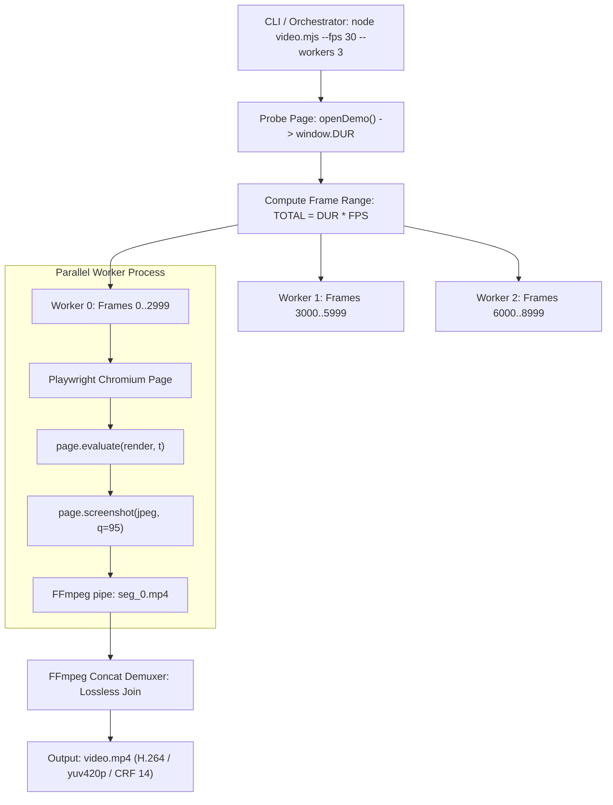

# LEMO-OPUSCAR TECHNICAL EVALUATION
## Deep Architecture, Rendering Engine & Style Analysis for Master AI

**Evaluation Date:** 2026-11-17  
**Repository Evaluated:** `https://github.com/lemomo-ai/lemo-opuscar`  
**Cloned Target:** `F:\Master AI\00_CORE_SYSTEM\research\external_repos\lemo-opuscar`  
**Repository Version:** `2.0.0` (Commit `main` tree, 3,942 files)  
**Evaluator:** Master AI Architecture & Systems Evaluation Engine  

---

## 1. EXECUTIVE SUMMARY & REPOSITORY OVERVIEW

`lemo-opuscar` is a video-as-code production library designed for autonomous coding agents. Instead of assembling videos using timeline GUI editors or static image concatenation, Lemo-Opuscar treats entire video sequences as deterministic client-side web applications written in HTML5 Canvas, WebGL, SVG, and Three.js.

The engine spins up headless Chromium instances via `playwright-core`, advances virtual time second-by-second (`window.render(t)`), takes JPEG/PNG screenshots of every frame, and pipes the uncompressed frame streams directly into FFmpeg stdin over standard IPC pipes. It includes integrated audio generation (procedural SFX, acoustic instrument sampling, offline/online TTS), automatic reading-speed verification (`readcheck.mjs`), and broadcast-grade audio mastering (two-pass `-14 LUFS` EBU R128 loudness normalization and true-peak limiting).

### Key Architectural Strengths
1. **Deterministic Programmatic Rendering:** Frame generation is completely reproducible and resolution-independent (scales from 1080p to 4K simply by passing `--size 3840x2160`).
2. **Parallel Segment Workers:** Video rendering is split across multi-process workers (`WK=3` to `WK=6`), where each worker renders a time slice of the video into a segment MP4 (`seg_0.mp4`, `seg_1.mp4`), followed by lossless concat.
3. **Comprehensive Style Library:** 101 production styles covering documentary, technical teardown, data visualization, cinematic title design, and educational animation.
4. **Decoupled Architecture:** While packaged with a Claude Code plugin wrapper, the core rendering engine (`core/render/video.mjs`, `page.mjs`, `lib.js`) is pure Node.js and can be invoked from any CLI, Python script, or agent platform.

---

## 2. THE RENDERING ENGINE & PAGE CONTRACT

### 2.1 The Page Contract

Every Lemo-Opuscar style implements a standardized client-side JavaScript lifecycle contract in its `index.html`:

```javascript
// 1. Readiness flag (waited on up to 180s by Playwright)
window.READY = true;

// 2. Deterministic frame render function at timestamp t (in seconds)
window.render = function(t) {
    // Computes layout, transforms, shaders, and draws canvas at time t
};

// 3. Exact duration in seconds
window.DUR = 60.0;

// 4. Optional cue & sound events exported for audio synchronization
window.EV = [
    { t: 0.5, type: "whoosh", gain: 0.8 },
    { t: 3.2, type: "text_reveal", text: "Chapter 1" }
];

// 5. Active on-screen text elements for reading-time verification
window.TEXTS = function(t) {
    return [
        { id: "headline", text: "The Sovereign Lion", x0: 200, y0: 100, x1: 800, y1: 180 }
    ];
};
```

### 2.2 Video Rendering Pipeline (`core/render/video.mjs`)



**Key Implementation Details:**
- **IPC Streaming:** Instead of writing millions of PNG files to disk, frames are captured into Node `Buffer` objects and piped directly into FFmpeg's `image2pipe` stdin (`-f image2pipe -framerate 30 -c:v mjpeg -i -`).
- **Segmented Concurrency:** By partitioning the timeline across 3 to 6 parallel browser workers, render times scale almost linearly with available CPU cores.
- **Process & Lock Hygiene:** Includes `.lock` files with PID ownership checks and stale lock recovery (clears locks older than 12 hours or from terminated PIDs).

---

## 3. STYLE CATALOG EVALUATION (101 STYLES)

The repository contains 101 distinct styles in `styles/`. Below is an evaluation of the most valuable styles categorized by Master AI production domains:

### 3.1 Wildlife & Documentary Production
| Style Slug | Visual Medium | Best Application in Master AI |
| :--- | :--- | :--- |
| `dark-documentary` | High-contrast filmic photography, subtle drift, cinematic typography | Historical, investigative, and nature documentaries. |
| `satellite-briefing` | Real Sentinel/Copernicus satellite imagery, geo-overlays, tracking | Habitat analysis, migration paths, geographical context. |
| `halftone-dossier` | Newspaper print, archival photocopies, classified dossier aesthetic | Source verification dossiers, investigative segments. |
| `visual-investigation`| Evidence boards, connected threads, forensic timeline mapping | Fact-checking breakdowns, complex multi-source narratives. |
| `archive-lighttable` | Transparent film slides, loupe magnification, lightbox glow | Archival photography display, historical comparisons. |
| `city-symphony` | Kinetic time-lapse montage, rhythmic cuts, architectural focus | Habitat urban encroachment, human-wildlife conflict. |
| `map-explainer` | 3D topographic relief, bathymetry, animated transit/range lines | Species range maps, conservation territory visualization. |

### 3.2 Educational & Technical Explainers
| Style Slug | Visual Medium | Best Application in Master AI |
| :--- | :--- | :--- |
| `chalkboard` | Simulated chalk on slate, mathematical derivations, organic dust | Academic lessons, mathematical models, biological classifications. |
| `whiteboard` | Dry-erase marker drawings, eraser smears, clean diagrams | Educational walkthroughs, algorithm explanations. |
| `flat-space-explainer`| Geometric 2D vector animation, bold typography, smooth transitions | Software architecture, system flowcharts, concept summaries. |
| `instruction-manual` | Technical line art, exploded isometric views, callout bubbles | Step-by-step guides, user manual demonstrations. |
| `teardown` | CAD-like layer separations, mechanical dissection, component lists | Hardware teardowns, anatomical breakdowns. |
| `telestrator` | Broadcast telestrator overlays, tactical arrows, live annotations | Sports analysis, tactical movement, tactical predator tracking. |

### 3.3 Data Visualization & Premium Social
| Style Slug | Visual Medium | Best Application in Master AI |
| :--- | :--- | :--- |
| `dataviz` | Animated bar charts, scatter plots, Sankey flows, trendlines | Statistical reports, model benchmark comparisons. |
| `hardcore-info` | High-density Bloomberg terminal aesthetic, telemetry data | High-frequency telemetry, performance metrics, financial data. |
| `data-physical` | 3D data sculptures, procedural materials, tactile representations | Executive summary presentations, premium infographics. |
| `dark-keynote` | Minimalist dark aesthetic, large typography, spotlight effects | Product launches, executive release announcements. |
| `glass-product` | Frosted glass morphism, WebGL refraction, soft lighting | Premium SaaS promo, mobile app showcase. |
| `caption-news` | High-visibility social subtitles, dynamic kinetic typography, b-roll | Mobile shorts (YouTube Shorts, TikTok, Instagram Reels). |

---

## 4. WINDOWS 11, NODE 24 & FFMPEG COMPATIBILITY

### 4.1 Node.js 24 Execution
- Lemo-Opuscar requires Node.js `>=20`.
- The current host environment runs **Node v24.16.0** with **npm 11.13.0**.
- All core render scripts (`video.mjs`, `still.mjs`, `page.mjs`, `events.mjs`) use modern ES modules (`"type": "module"` in `package.json`), which execute without modification under Node 24.

### 4.2 Windows-Specific Concurrency & File System Considerations
1. **File Locking:** `video.mjs` implements Windows-safe process checking:
   ```javascript
   const alive = pid => {
     try { process.kill(pid, 0); return true; } catch (e) { return e.code === 'EPERM'; }
   };
   ```
2. **Segment File Locking (`EBUSY`):** On Windows, when an FFmpeg worker process exits, the operating system holds file handles briefly. `video.mjs` specifically includes retry loops with `maxRetries: 10, retryDelay: 100` to prevent `EBUSY` crashes during directory cleanup.
3. **Shell Script Incompatibility (`mux.sh`):**
   `core/render/mux.sh` is written in bash. On native Windows (outside WSL / Git Bash), executing `sh mux.sh` will fail unless routed through `bash.exe`. For Master AI integration, this logic must be wrapped in a pure-Python script using our existing FFmpeg runner.
4. **FFmpeg Path Resolution:**
   `video.mjs` executes `spawn('ffmpeg', ...)`. If `ffmpeg.exe` is not installed on the system PATH, the subprocess fails with `ENOENT`. In Master AI, FFmpeg is provided via Python's `imageio_ffmpeg`. Therefore, any wrapper must inject `imageio_ffmpeg.get_ffmpeg_exe()` into the `PATH` environment variable before launching Node.

---

## 5. HARDWARE & RESOURCE REQUIREMENTS

| Resource | Minimum Requirement | Recommended for Master AI | Host Reality (Windows 11) |
| :--- | :--- | :--- | :--- |
| **CPU** | 4 physical cores | 8+ cores (Intel Core i5 / i7 / Ryzen) | Intel Core i5-1245U (10 cores, 12 threads) |
| **RAM** | 8 GB total | 16 GB total | 16 GB available |
| **GPU / WebGL** | Software WebGL (SwiftShader) | Dedicated GPU (NVIDIA / AMD / Intel Iris Xe) | Intel Iris Xe Graphics (Direct3D 11 via ANGLE) |
| **Disk Space** | 2 GB for repo + headless browser | 10 GB (temp segment caches + footage) | 50+ GB available on `F:\` |

### WebGL ANGLE Backend on Windows
On Windows 11, Playwright Chromium leverages ANGLE with the Direct3D 11 backend (`--use-angle=d3d11`). This allows hardware-accelerated WebGL rendering directly on Intel Iris Xe or dedicated GPUs without crashing. For cloud VMs without GPU hardware, Lemo-Opuscar supports `LEMO_ANGLE=swiftshader` for CPU software rasterization.

---

## 6. PYTHON 3.14 DEPENDENCY CONFLICT ANALYSIS

Master AI runs on Python 3.14. Analyzing Lemo-Opuscar's Python requirements reveals the following compatibility considerations:

| Dependency | Purpose in Lemo-Opuscar | Python 3.14 Compatibility | Risk / Mitigation |
| :--- | :--- | :--- | :--- |
| **`kokoro-onnx`** | Offline neural voice generation | **INCOMPATIBLE** (`needs Python 3.11-3.13`) | **High Risk.** Do not install. Master AI already uses Microsoft Edge TTS (`hi-IN-MadhurNeural`) which works perfectly. |
| **`numba`** | Plucked string acoustic modeling | **INCOMPATIBLE** (No 3.14 wheels) | **High Risk.** Numba does not support Python 3.14 yet. Plucked instrument scripts should not be installed. |
| **`av<19`** | PyAV audio file decoding | **CONFLICT** (`faster-whisper 1.2` bug) | PyAV 19 dropped `metadata_errors`. Master AI already patched this in Phase 6.5 (`faster_whisper/audio.py`). |
| **`pillow`, `scipy`, `numpy`** | Contact sheets, filters, audio arrays | **COMPATIBLE** | Already installed and functioning in `F:\Master AI\.venv`. |
| **`faster-whisper`** | Speech intelligibility check | **COMPATIBLE** | Already installed (`v1.2.1`) and functioning on CPU INT8 in Master AI. |

---

## 7. OPERATIONAL PROFILE: NETWORK, SUBPROCESSES & FILE SYSTEM

1. **Network Calls:**
   - `core/render/serve.mjs`: Starts local HTTP server on `127.0.0.1` for Playwright page serving.
   - `core/tts/tts_zh.py`: Connects to `wss://speech.platform.bing.com` for Edge TTS.
   - `tools/fetch.sh`: Downloads models and soundfonts when explicitly requested.
   - `core/image/gen_image.py`: Calls external Codex CLI API for generative imagery.
   - **Engine Isolation:** The core video rendering pipeline (`video.mjs`, `still.mjs`) makes **zero external network requests**; all assets are served from the local HTTP server.
2. **Subprocess Spawning:**
   - Spawns Chromium child processes via Playwright.
   - Spawns `ffmpeg` processes for frame encoding.
   - Spawns `node` child workers for parallel rendering.
3. **File System Behavior:**
   - Reads local style templates, JavaScript assets, and font files.
   - Writes temporary segments to `.<base>_segs-<rand>/` and deletes them immediately upon completion.
   - Writes final video files to specified `--out` path.

---

## 8. SUMMARY VERDICT ON TECHNICAL CAPABILITY

Lemo-Opuscar's core headless rendering pipeline represents a significant technical upgrade over Master AI's current procedural PIL renderer. By executing full HTML5 Canvas and WebGL scenes inside headless Chromium and piping frames directly to FFmpeg, Master AI can achieve broadcast-quality motion graphics, animated typography, and dynamic data visualizations without relying on static illustrations or manual keyframing.
