# MASTER AI — COMPREHENSIVE MULTIMEDIA PRODUCTION & PUBLISHING INTEGRATION BLUEPRINT

> **Research Phase**: Phase 6.4 Autonomous GitHub Ecosystem Discovery & Research  
> **Target Architecture**: Master AI End-to-End Production & Multi-Platform Publishing Pipeline  
> **Host Environment**: Windows 11 Enterprise (Intel Core i5-1245U, 32GB RAM, Intel Iris Xe)  
> **Date**: 2026-11-17  

---

## 1. Architectural Overview

This blueprint maps the end-to-end transformation of Master AI from a multi-agent framework into an autonomous, professional-grade multimedia studio and publishing platform.
It integrates the top open-source candidates into an 18-stage, fail-safe pipeline where native Master AI components orchestrate external tools, models, and services with strict approval boundaries.

```mermaid
flowchart TD
    CMD["1. USER NATURAL LANGUAGE COMMAND"] --> RES["2. RESEARCH AGENT (yt-dlp, browser-use, Qdrant)"]
    RES --> FACT["3. FACT & SOURCE VERIFICATION (Wikipedia, Academic APIs)"]
    FACT --> SCR["4. DURATION-AWARE SCRIPTWRITER (Qwen2.5 / Ollama)"]
    SCR --> STB["5. STORYBOARD DIRECTOR (FireRed-OpenStoryline, Scene Planner)"]
    STB --> VIS_DISC["6. REAL FOOTAGE DISCOVERY (pyWikiCommons, Pexels API)"]
    VIS_DISC --> VIS_GEN["7. GATED AI VIDEO & IMAGE GEN (Wan2.1, FLUX.1 via ComfyUI Cloud)"]
    VIS_DISC --> VOICE["8. HINDI NEURAL VOICEOVER (edge-tts / Indic-TTS / Sherpa-ONNX)"]
    VIS_GEN --> VOICE
    VOICE --> BGM["9. SOUNDSCAPE & BGM (FFmpeg filters, CC-0 FreeMusicArchive)"]
    BGM --> EDIT["10. AUTOMATED VIDEO EDITING (openfilm Web-to-Video, auto-editor, FFmpeg)"]
    EDIT --> SUB["11. SUBTITLE SYNCHRONIZATION (whisperX, faster-whisper ASR)"]
    SUB --> QA["12. STRICT MEDIA & COPYRIGHT QA (PySceneDetect, faster-whisper WER)"]
    QA --> THUMB["13. THUMBNAIL STUDIO & SEO (Pillow / openfilm Studio, Qwen2.5)"]
    THUMB --> PREP["14. PLATFORM-SPECIFIC VIDEO PREPARATION (16:9 Landscape & 9:16 Shorts)"]
    PREP --> APPR["15. HUMAN APPROVAL CENTER (Zero-Unauthorized Publishing Gate)"]
    APPR --> PUB["16. MULTI-PLATFORM PUBLISHING (socialdrop, postiz-app MCP)"]
    PUB --> ANALY["17. PERFORMANCE ANALYTICS (YouTube Analytics, yt-dlp metrics)"]
    ANALY --> FEED["18. FEEDBACK-DRIVEN IMPROVEMENT (Qdrant Long-Term Memory)"]

    style APPR fill:#ff9900,stroke:#333,stroke-width:2px,color:#000
    style QA fill:#00cc66,stroke:#333,stroke-width:2px,color:#000
```



---

## 2. 18-Stage End-to-End Execution Matrix

| Stage | Name | Responsible Engine / Tool | Native vs. Integrated | Host Runtime | Est. Cost | Failure Handling & Fallback |
| :---: | :--- | :--- | :---: | :---: | :---: | :--- |
| **1** | **User Goal Interpretation** | `CentralOrchestrationEngine` | **Native** | Local CPU | $0.00 | Clarify goal via user prompt |
| **2** | **Research & Scraping** | `browser-use` + `yt-dlp` | **Integrated** | Local CPU | $0.00 | Fall back to Qdrant local knowledge base |
| **3** | **Fact Verification** | `research_agent` + Wikipedia API | **Native** | Local CPU | $0.00 | Flag unverified claims for scriptwriter review |
| **4** | **Scriptwriting (Hindi)** | `scriptwriter` (Qwen2.5-7B via Ollama) | **Native** | Local CPU | $0.00 | Fall back to local Llama-3.2 or template prompts |
| **5** | **Storyboard & Pacing** | `FireRed-OpenStoryline` + `storyboard_director` | **Integrated** | Local CPU | $0.00 | Native 6-scene duration formula ($T_{\text{target}} / N$) |
| **6** | **Real Footage Discovery** | `pyWikiCommons` + `pexels-api-python` | **Integrated** | Local CPU | $0.00 | Query Wikimedia CC-0 -> Pexels -> Pixabay |
| **7** | **AI Visual Generation** | `Wan2.1` / `LTX-Video` via ComfyUI Cloud | **Integrated** | Cloud GPU | ~$0.04/clip | Gated by `ApprovalCenter`; falls back to stock footage |
| **8** | **Hindi Voiceover** | `edge-tts` (`hi-IN-MadhurNeural`) | **Native** | Local Network | $0.00 | Fall back to `sherpa-onnx` / `Indic-TTS` (offline) |
| **9** | **Audio Engineering & BGM** | `AudioManager` + FreeMusicArchive CC-0 | **Native** | Local CPU | $0.00 | Procedural ambient soundscapes (`savannah_wind`) |
| **10** | **Video Editing & Assembly** | `openfilm` + `auto-editor` + `FFmpeg 7.1` | **Integrated** | Local CPU | $0.00 | Native FFmpeg `concat` filter with ducking |
| **11** | **Subtitle Synchronization** | `whisperX` + `faster-whisper` | **Integrated** | Local CPU | $0.00 | Exact word-level Devanagari SRT/ASS generation |
| **12** | **Media & License QA** | `MediaQualityAssuranceAuditor` + `PySceneDetect` | **Native** | Local CPU | $0.00 | 12 fail-closed checks; loop back on failure |
| **13** | **Thumbnail & SEO** | `openfilm Studio` + `ThumbnailStudio` | **Integrated** | Local CPU | $0.00 | High-CTR 1280x720 graphic with verified title |
| **14** | **Format Preparation** | `FFmpeg 7.1` (16:9 1080p and 9:16 Shorts) | **Native** | Local CPU | $0.00 | Render both YouTube standard and Shorts variants |
| **15** | **Approval Gate** | `ApprovalCenter` (`TKT-*` Ticket Validation) | **Native** | Local CPU | $0.00 | **HARD BLOCK**: No external publish without token |
| **16** | **Multi-Platform Publish** | `socialdrop` + `postiz-app` (MCP) | **Integrated** | Local / Docker | $0.00 | Upload to YouTube, TikTok, X, Instagram |
| **17** | **Analytics & Retention** | `google-api-python-client` (YouTube API) | **Integrated** | Local CPU | $0.00 | Collect views, watch time, CTR, comments |
| **18** | **Memory & Feedback** | `Qdrant` + `MemoryBridge` | **Native** | Local CPU | $0.00 | Store retention lessons in long-term memory |

---

## 3. Detailed Component Deep Dives

### Stage 6: Real Footage Acquisition Pipeline
To resolve the critical finding of Phase 6.3 (where synthetic illustrations were labeled as Wikimedia Commons media):
1. **Automated Search Priority**:
   ```
   1. Search Wikimedia Commons for exact CC-0 or Public Domain animal/nature videos via pyWikiCommons.
   2. If no CC-0 video exists, search Pexels API for free commercial wildlife MP4 clips.
   3. If no stock video is found, download high-resolution CC-0 photography and apply openfilm WebGL motion.
   4. If all fail, request human approval for Cloud AI video generation (Wan2.1).
   ```
2. **Provenance Record**: Every downloaded clip saves a `.provenance.json` sidecar detailing the exact remote URL, creator name, license type, and checksum.

### Stage 8 & 11: Speech Synthesis & Linguistic Verification Pipeline
1. **Primary Synthesis**: `edge-tts` 7.3.1 synthesizes `hi-IN-MadhurNeural` with millisecond `SentenceBoundary` events.
2. **Offline Fallback**: `sherpa-onnx` with Indic-TTS models synthesizes offline Hindi speech on CPU if internet access is lost.
3. **Automated ASR Linguistic Audit**: Immediately upon synthesis, `faster-whisper` (int8 on CPU) transcribes the generated WAV file:
   - Computes Word Error Rate (WER) against `script_hindi.json`.
   - If $\text{WER} > 15\%$, voice synthesis is rejected and retried with alternate pacing.
   - This directly and permanently resolves the Phase 6.3 *NOT INDEPENDENTLY VERIFIED* intelligibility finding.

### Stage 10: Programmatic Video Assembly (`openfilm` + `FFmpeg`)
1. **Titles & Motion Typography**: `openfilm` renders dynamic HTML5/Canvas opening title cards and chapter markers using headless Chromium.
2. **Cut Pacing**: `auto-editor` strips awkward breathing pauses and silences between scene cuts.
3. **Assembly**: Master AI's native `VideoEditingEngine` concatenates 1080p footage, mixes ambient audio with -14dB ducking, and encodes via FFmpeg 7.1 with H.264 High Profile and AAC audio.

### Stage 15 & 16: Zero-Paid Human Approval & Multi-Platform Publishing
1. **Staged Publication Bundle**: The finished video, thumbnail, subtitles, and `PUBLICATION_METADATA.json` are placed in `publication_bundle/`.
2. **Approval Ticket Created**: `ApprovalCenter.create_ticket` creates an `EXTERNAL_PUBLISH` ticket (e.g. `TKT-f11a6c3c`) with status `PENDING`.
3. **Release Execution**:
   - Only when a human operator issues an `approve_ticket(ticket_id, auth_token)` command does `socialdrop` or `postiz-app` receive authorization to execute uploads.
   - Credentials are never committed to Git and are read from secure Windows Credential Manager storage.
