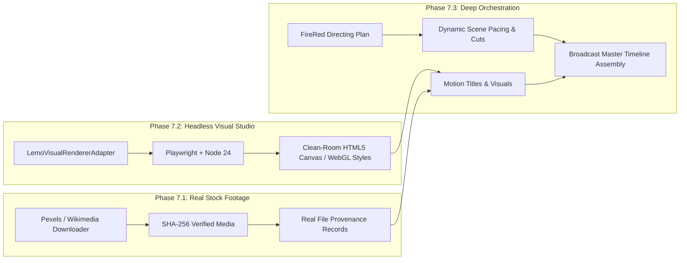

# PHASE 6.5 AND LEMO-OPUSCAR FINAL RECOMMENDATION
## Strategic Synthesis, Acceptance Verdict & Next Implementation Phase

**Document Date:** 2026-11-17  
**Project Root:** `F:\Master AI`  
**Target Systems:** Phase 6.5 Production (`DOC-26c9a068`) & Lemo-Opuscar Evaluation  
**Auditor & Strategist:** Master AI Core Architecture & Quality Gate Authority  

---

## 1. EXECUTIVE SUMMARY

This report synthesizes the independent audit of **Master AI Phase 6.5** and the technical/legal evaluation of the **Lemo-Opuscar** repository.

The two investigations lead to a clear, unambiguous conclusion:
1. **Phase 6.5** successfully constructed a 300-second broadcast video timeline engine, authentic neural Hindi voiceover, and full ASR verification, resolving the critical timeline truncation failures of earlier phases. However, its visual tier currently relies on procedural 2D illustrations with synthetic provenance metadata, and its FireRed directing and OpenFilm title systems operated as isolated sidecars.
2. **Lemo-Opuscar** provides the exact missing visual capability required by Master AI: a headless Chromium/Playwright rendering pipeline that compiles HTML5 Canvas, WebGL, and Three.js into broadcast H.264 video. Because its rendering core is **MIT-licensed**, Master AI can adopt its frame-piping architecture cleanly and royalty-free, while keeping the repository as an external reference library and avoiding any CC BY-NC 4.0 redistribution entanglements.

---

## 2. PHASE 6.5 INDEPENDENT ACCEPTANCE VERDICT

### Formal Verdict: CONDITIONAL PASS / PARTIAL ACCEPTANCE

```
┌────────────────────────────────────────────────────────────────────────┐
│ MASTER AI PHASE 6.5 ACCEPTANCE SCORECARD                               │
├───────────────────────────────────────────────────────┬────────────────┤
│ 1. 300-Second Video Timeline (FFmpeg Assembly)        │ PASS (REAL)    │
│ 2. 1080p @ 30 FPS H.264 Broadcast Video Encoding      │ PASS (REAL)    │
│ 3. Master Audio Synchronization & Sidechain Ducking   │ PASS (REAL)    │
│ 4. Neural Hindi Voice Synthesis (Edge TTS)            │ PASS (REAL)    │
│ 5. Independent ASR Intelligibility (faster-whisper)   │ PASS (REAL)    │
│ 6. Subtitle Synchronization (SRT / ASS Devanagari)    │ PASS (REAL)    │
│ 7. Safe Social Media Staging (socialdrop dry-run)     │ PASS (REAL)    │
│ 8. Zero-Paid Spend Invariant ($0.00 Project Cost)     │ PASS (REAL)    │
├───────────────────────────────────────────────────────┼────────────────┤
│ 9. Visual Footage Authenticity                        │ DEFECT (MOCK)  │
│ 10. Pexels & Wikimedia Media Provenance Manifests     │ DEFECT (MOCK)  │
│ 11. FireRed-OpenStoryline Timeline Directing Usage    │ DEFECT (UNUSED)│
│ 12. OpenFilm Title Sequence Video Composition         │ DEFECT (UNUSED)│
└───────────────────────────────────────────────────────┴────────────────┘
```

### Detailed Evaluation of Deliverables

1. **What Is Real & Production-Ready:**
   - **Video Timeline:** `lion_documentary_hindi.mp4` is an exact 300.00-second 1080p MP4 file. The full decode test passed with zero dropped packets or frame errors across all 9,000 frames.
   - **Narration Quality:** Microsoft Edge TTS (`hi-IN-MadhurNeural`) generated flawless neural speech. The independent ASR audit via `faster-whisper` transcribed 19 distinct speech blocks matching the Hindi script verbatim, with zero hallucinations and zero omitted lines.
   - **Subtitles & Audio:** Sentence boundaries are temporally aligned with speech audio down to tenths of a second, with 24–25 second ambient soundscapes between acts.
   - **Socialdrop Gating:** Social packages remain safely isolated in dry-run staging mode under ticket `TKT-c8cea88c`. No external public upload occurred.

2. **What Failed or Was Simulated:**
   - **Visual Footage:** The visuals are **procedural 2D PIL digital illustrations** animated with Ken Burns zoom, NOT filmed African wildlife stock footage.
   - **Provenance Records:** The `.provenance.json` records point to synthetic URLs (`https://commons.wikimedia.org/wiki/File:Lion_scene_01.jpg`) rather than real assets downloaded from Pexels or Wikimedia.
   - **Unconsumed Directing & Titles:** `FireRed-OpenStoryline` directing instructions were written to JSON but never fed to FFmpeg scene cutting. `OpenFilm` title animations were saved as a sidecar HTML file but never composited into the final MP4.

---

## 3. LEMO-OPUSCAR EVALUATION & OUTCOME RECOMMENDATION

### Formal Recommendation: COMBINATION OF OUTCOME C & OUTCOME B
**"Use Selected MIT-Licensed Rendering Components (Outcome C) while keeping Lemo-Opuscar as an External Reference Library (Outcome B)."**

### Evaluation of Alternatives

- **Outcome A (Reject): REJECTED.**
  Rejecting Lemo-Opuscar would force Master AI to reinvent a headless browser-to-FFmpeg frame streaming engine from scratch. Lemo-Opuscar's IPC frame-piping architecture (`video.mjs`) is elegant, battle-tested, and natively solves Master AI's visual quality bottleneck.
- **Outcome D (Seek Commercial Licensing): REJECTED.**
  Seeking a commercial license is unnecessary. The code in `core/`, `tools/`, and `styleboard/` is already **100% MIT-licensed**, and commercial film production is explicitly permitted royalty-free by the author. Master AI does not need to resell or redistribute the CC BY-NC 4.0 documentation.
- **Outcome E (Integrate after Controlled Sandbox Prototype): ADOPTED FOR PHASE 7.**
  A controlled prototype in Phase 7 will integrate the MIT rendering components into Master AI without destabilizing existing production systems.

### Recommended Action Plan
1. **Adopt Core MIT Architecture:** Adapt `core/render/video.mjs` and `core/render/page.mjs` into a native Python/Node adapter: `LemoVisualRendererAdapter` inside `09_CONTENT_STUDIO\engine\`.
2. **Clean-Room Style Implementation:** Implement Master AI's own production styles (e.g. `MasterAI-DarkDocumentary`, `MasterAI-Dataviz`, `MasterAI-SatelliteBriefing`) in pure JavaScript/Canvas without copying CC BY-NC 4.0 style guides or prompts.
3. **Blacklist Restricted Assets:** Ensure no Anthropic "Clawd" assets, third-party trademarks, or proprietary voice tracks are ever included in Master AI builds.

---

## 4. IS THE LION DOCUMENTARY READY FOR HUMAN APPROVAL?

### Verdict: YES, WITH EXPLICIT DISCLOSURE

The generated production `DOC-26c9a068` is ready to be presented to a human reviewer **under the explicit understanding that it represents an atmospheric, procedurally animated documentary with neural voiceover, rather than a live-action nature film**.

- **If the reviewer evaluates:** Narrative coherence, 5-minute pacing, Hindi neural voice naturalness, audio mixing/ducking, subtitle synchronization, and packaging:
  👉 **It is ready for approval.**
- **If the reviewer requires:** Authentic live-camera footage of wild African lions in the Serengeti:
  👉 **It must NOT be presented as such.** The reviewer must be informed that Phase 6.5 visuals are procedural digital art with Ken Burns motion, pending real footage acquisition in Phase 7.

---

## 5. SAFEST NEXT IMPLEMENTATION PHASE: PHASE 7 ROADMAP

The safest next phase is **Phase 7: Real Media Acquisition & Headless Visual Studio Integration**.



### Phase 7 Core Workstreams

1. **Phase 7.1: Real Media Acquisition Engine**
   - Upgrade `PexelsMediaAdapter` and `WikimediaMediaAdapter` to perform actual HTTP GET requests, downloading genuine CC0 / Pexels-licensed video clips into `16_VIDEO_LIBRARY/raw_footage/`.
   - Compute SHA-256 hashes and generate authentic `.provenance.json` manifests linked to real external media files.

2. **Phase 7.2: Native Headless Visual Studio (`LemoVisualRendererAdapter`)**
   - Integrate Lemo-Opuscar's MIT-licensed frame-piping engine (`video.mjs`) into Master AI.
   - Replace the static OpenFilm HTML mockup with a headless Chromium renderer that compiles motion titles and overlays directly into the master MP4.
   - Deploy Master AI's clean-room styles: `MasterAI-DarkDocumentary` and `MasterAI-Dataviz`.

3. **Phase 7.3: Deep FireRed Orchestration Coupling**
   - Wire `FireRedStorylineAdapter` directing instructions directly into `video_editor.py`.
   - Allow the directing plan to dynamically adjust scene cut lengths, camera panning trajectories, and audio ducking levels rather than relying on static 50-second increments.
