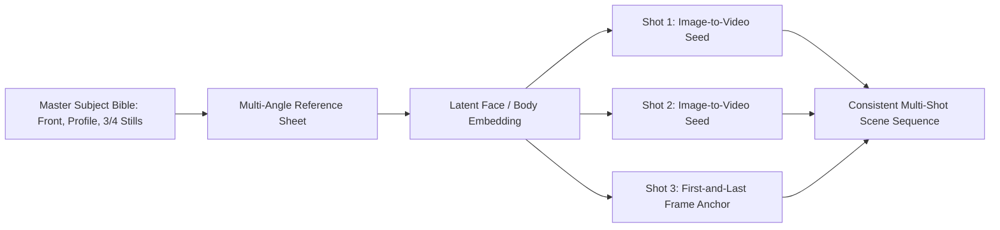

# AI VIDEO MODEL COMPARISON & CAPABILITIES AUDIT
## Comprehensive Evaluation of Generative Video Models, APIs, Pricing & Character Consistency

**Document Version:** 1.0.0-phase7.0  
**Project Root:** `F:\Master AI`  
**Target Path:** `00_CORE_SYSTEM\research\phase-7\AI_VIDEO_MODEL_COMPARISON.md`  
**Classification:** Research, Benchmark Data & Integration Evaluation  
**Status:** Approved for Review  

---

## 1. EXECUTIVE SUMMARY & MODEL LANDSCAPE

Generative AI video has transitioned from short, morphing clips into multi-shot cinematic engines supporting camera trajectory choreography, reference image conditioning, and native synchronized audio.

For Master AI, no single video model satisfies all requirements across cost, speed, local execution, and visual realism. The platform requires a tiered multi-model strategy:
1. **Cloud Flagship Tier:** Google Veo 3.1 and Kling 3.0 / Runway Gen-4 for hero documentary shots, photorealistic animal motion, and broadcast-quality commercials.
2. **Cost-Optimized Cloud Tier:** MiniMax Hailuo H3 and Kling v2.5 Turbo ($0.04–$0.08/sec) for rapid iteration, social reels, and high-volume scene b-roll.
3. **Open-Weights / Self-Hosted Tier:** Alibaba Wan 2.1 (`Wan2.1-T2V-1.3B` and `Wan2.1-I2V-14B`) and Tencent HunyuanVideo for private, zero-subscription generation on dedicated cloud GPU clusters (Modal, RunPod) or high-end local workstations.

---

## 2. COMPREHENSIVE MODEL COMPARISON MATRIX

| Model / Provider | Primary Modalities | Max Native Resolution | Native Audio | Camera Movement Controls | Character / Subject Consistency | Official API Availability | Pricing (Estimated per Sec) | Commercial Rights |
| :--- | :--- | :--- | :--- | :--- | :--- | :--- | :--- | :--- |
| **Google Veo 3.1** | T2V, I2V, V2V, Upscale | 1080p / 4K | **YES** (Synchronized) | Pan, tilt, zoom, dolly, track | High (via Reference Embeddings) | Google Cloud Vertex AI / Gemini API | **$0.03 – $0.05** (Lite)<br>**$0.10** (Fast)<br>**$0.20 – $0.50** (Quality) | **Commercial Use Allowed** |
| **Kling AI (v2.5/3.0)** | T2V, I2V, V2V, Multi-Shot | 1080p / 4K | **YES** (Optional addon) | Horizontal, vertical, roll, zoom | High (Face & Outfit Lock in v3.0) | Kuaishou Kling API / Fal.ai | **$0.042** (Turbo)<br>**$0.070** (Pro)<br>**$0.176 – $0.44** (3.0/4K) | **Commercial Use Allowed** |
| **Runway (Gen-3/4.5)** | T2V, I2V, V2V, Act-One | 1080p / 4K (Upscale) | NO (Separate audio) | Motion Brush, Multi-axis Director | High (Act-One facial performance transfer) | Runway Developer API | **$0.05** (Turbo)<br>**$0.12** (Gen-4.5) | **Commercial Use Allowed** |
| **MiniMax (Hailuo H3)** | T2V, I2V | 768p / 1080p / 2K | **YES** (Stereo Sound) | Standard prompt camera syntax | Moderate (relies on initial I2V seed) | MiniMax International API / OpenRouter | **$0.042 – $0.08** (Standard)<br>**$0.13** (2K + Audio) | **Commercial Use Allowed** |
| **Alibaba Wan 2.1** | T2V, I2V, First-Last-Frame | 720p / 1080p | NO | Prompt & motion trajectory vectors | Very High (First-Last Frame interpolation) | Open Weights (Hugging Face / ModelScope) | **$0.00** (Self-hosted hardware)<br>Cloud GPU compute: ~$0.015/sec | **Apache 2.0 (Open Commercial)** |
| **Tencent HunyuanVideo**| T2V, I2V | 720p / 1080p | NO | Standard prompt direction | Moderate to High | Open Weights (Hugging Face / GitHub) | **$0.00** (Self-hosted)<br>Compute: ~$0.020/sec | **Tencent Open License (Commercial)** |
| **Luma Dream Machine** | T2V, I2V, Loop | 720p / 1080p | NO | Camera paths, keyframing | Moderate (Keyframe interpolation) | Luma API / Replicate | **$0.06 – $0.10** | **Commercial Use Allowed** |
| **Gemini Omni 1.2** | Multimodal T2V / V2V | 1080p | NO | Prompt-guided transformation | High (Context window multi-turn) | Google GenAI SDK | Metered via Gemini tokens | **Commercial Use Allowed** |

---

## 3. IN-DEPTH MODEL PROFILES

### 3.1 Google Veo 3.1 (Flagship Cloud Integration)
- **Developer Interface:** Google Cloud Vertex AI REST & Python SDK (`google-cloud-aiplatform`).
- **Core Strengths:** Exceptional photorealism in natural lighting, water dynamics, and animal anatomy. Native synchronized environmental audio generation (wind rustling, footsteps, distant calls). Direct integration with Google Cloud IAM and audit logging.
- **Key Limitations:** Strict enterprise safety filters; occasional rejection of prompt keywords related to predation or conflict even in educational documentary contexts.
- **Pricing Breakdown:**
  - Veo Lite: $0.03 – $0.05 / sec (ideal for background b-roll drafts).
  - Veo Fast: $0.10 / sec (standard production speed).
  - Veo Quality + Audio: $0.40 – $0.75 / sec (hero scene production).
- **Master AI Strategic Role:** Primary flagship provider for high-stakes broadcast documentaries and commercial client deliverables.

### 3.2 Kling AI v2.5 / v3.0 (Precision Motion & Camera Control)
- **Developer Interface:** Official Kling HTTP API (`https://api.klingai.com`) and unified API routers (Fal.ai, PiAPI).
- **Core Strengths:** Best-in-class multi-axis camera control (exact pan, tilt, roll, and zoom percentages). Kling 3.0 introduces character identity locking, enabling a specific character or animal to reappear across distinct scenes with matching physical markings.
- **Key Limitations:** Server load during peak hours can introduce generation queue latency (30s to 180s per 5s clip).
- **Pricing Breakdown:** Standard 720p clips at $0.042/sec ($0.21 per 5s clip); Pro 1080p at $0.070/sec ($0.35 per 5s clip).
- **Master AI Strategic Role:** Primary engine for complex camera choreography (e.g. tracking shots, orbit around subject) and character-centric narratives.

### 3.3 MiniMax Hailuo H3 (Cost & Audio Efficiency)
- **Developer Interface:** MiniMax API (`https://api.minimax.chat/v1/video_generation`).
- **Core Strengths:** Extremely rapid generation speeds with natural human movement and organic fluid physics. Native stereo audio generation creates impactful soundscapes at a fraction of enterprise cloud rates.
- **Key Limitations:** Limited fine-grained camera direction compared to Kling.
- **Pricing Breakdown:** $0.042 – $0.08 / sec for 768p/1080p video; $0.13 / sec for 2K with native audio.
- **Master AI Strategic Role:** High-volume social media production (YouTube Shorts, TikTok, Instagram Reels) and cost-optimized draft passes.

### 3.4 Alibaba Wan 2.1 (Open-Weights Sovereign Foundation)
- **Developer Interface:** Hugging Face `diffusers`, ComfyUI nodes, and native Python inference script.
- **Core Strengths:** Completely open weights under Apache 2.0. Eliminates API token costs and external privacy concerns. The `Wan2.1-FLF2V-14B` (First-Last-Frame) model allows Master AI to generate the first and last frames via Image AI and force the video engine to interpolate an exact motion trajectory between them, guaranteeing seamless scene transitions.
- **Hardware Requirement:**
  - `Wan2.1-T2V-1.3B`: Requires ~8 GB VRAM (runnable on consumer RTX 4070/4080/4090).
  - `Wan2.1-I2V-14B`: Requires 24–32 GB VRAM (runnable on RTX 4090 with quantization, or cloud NVIDIA A10G/L4/A100).
- **Master AI Strategic Role:** The sovereign, zero-subscription foundation for Master AI when paired with ephemeral cloud GPU workers (e.g. Modal / RunPod spot instances).

---

## 4. MULTI-SHOT CHARACTER & SUBJECT CONSISTENCY

One of the largest hurdles in cinematic AI video is maintaining consistent character faces, clothing, and animal anatomy across multiple cuts. Master AI achieves consistency through a four-tier pipeline:



1. **Reference Sheet Anchoring (Image-to-Video Priority):**
   Never generate sequential shots using text-to-video (T2V) alone. Text prompts produce divergent seeds. Master AI generates a multi-angle high-resolution character reference sheet (front, side, action) using standard Image AI, and seeds every subsequent video shot via Image-to-Video (I2V).
2. **First-and-Last Frame Constraints (`Wan2.1-FLF2V` / Runway Keyframes):**
   For critical transitions, Master AI renders the start frame and destination frame, forcing the video model to generate the intermediate motion without mutating subject morphology.
3. **Face & Subject Masking Post-Pass:**
   If slight facial or texture drift occurs between shots, Master AI applies an automated face-restoration / texture re-projection pass using local InsightFace / CodeFormer models during Stage 08 (Shot Harmonization).

---

## 5. REUSABLE MASTER AI ADAPTER SPECIFICATION

To prevent vendor lock-in, all video generators adhere to Master AI's `BaseVideoAdapter` interface:

```python
class BaseVideoAdapter(ABC):
    """Universal interface for photorealistic AI video generation providers."""

    @abstractmethod
    def generate_text_to_video(
        self,
        prompt: str,
        duration_sec: float,
        resolution: Tuple[int, int] = (1920, 1080),
        fps: int = 24,
        camera_controls: Optional[Dict[str, Any]] = None
    ) -> VideoGenerationResult:
        pass

    @abstractmethod
    def generate_image_to_video(
        self,
        image_path: str,
        prompt: str,
        duration_sec: float,
        resolution: Tuple[int, int] = (1920, 1080),
        motion_strength: float = 1.0
    ) -> VideoGenerationResult:
        pass

    @abstractmethod
    def check_cost(self, duration_sec: float, resolution: Tuple[int, int]) -> Dict[str, Any]:
        """Calculates expected spend. Blocks execution if cost > approved ticket budget."""
        pass
```

### Safety & Invariant Enforcement
- Before calling any paid external API, the adapter executes `check_cost()`.
- If `cost > $0.00` and no valid `ApprovalCenter` ticket ID (`TKT-*`) is attached, the request **fails closed** immediately with status `COST_APPROVAL_REQUIRED`.
- The user is notified with an exact dollar estimate before any billable bytes are dispatched.
