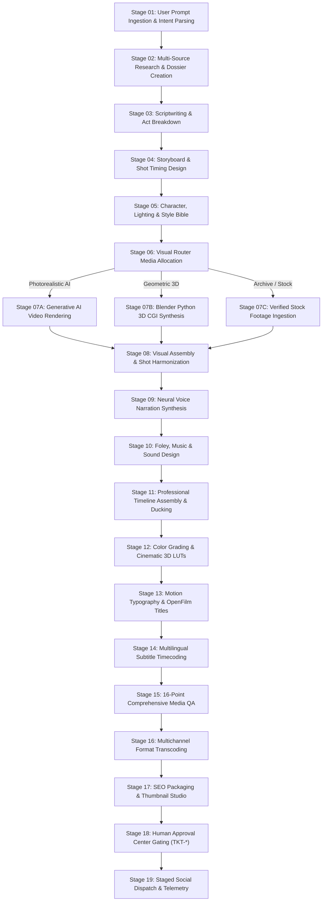

# MASTER AI — PHASE 7.0
# CINEMATIC AI VIDEO PRODUCTION HOUSE ARCHITECTURE
## End-to-End Autonomous Studio Design, Modular Subsystems & Lifecycle State Machine

**Document Version:** 1.0.0-phase7.0  
**Project Root:** `F:\Master AI`  
**Target Path:** `00_CORE_SYSTEM\research\phase-7\PHASE_7_CINEMATIC_PRODUCTION_ARCHITECTURE.md`  
**Classification:** Research, System Architecture & Operational Blueprint  
**Status:** Approved for Review & Controlled Validation Planning  

---

## 1. VISION & STRATEGIC OBJECTIVE

Master AI is evolving from a single-format documentary compiler into a **comprehensive, autonomous cinematic production house**. 

The target system is not a toy prompt-to-video wrapper. It is an industrial-grade multi-agent media platform capable of transforming a natural language brief—such as *"Create a cinematic 3D documentary about lions"* or *"Produce a suspenseful 60-second sci-fi teaser with orchestral sound design"*—into a broadcast-ready, multichannel media package with full audio-visual polish, factual rigor, copyright clearance, and staged multi-platform distribution.

### Core Architectural Invariants
1. **Genre Agnosticism:** Native support for 12+ production genres: Wildlife, Science, Historical Docudrama, Horror/Suspense, Fictional Storytelling, Automotive/Industrial, Gaming Cinematics, Motivational Shorts, Product Advertisements, and News Explainers.
2. **Dual-Engine Visual Core:** Clear separation between **Engine A (Photorealistic Generative AI Video)** and **Engine B (Deterministic 3D CGI Scene Synthesis)**. The orchestrator routes scenes to the optimal visual medium rather than forcing one paradigm onto every shot.
3. **Multi-Provider Fallback Routing:** Zero single-point-of-failure. Interchangeable adapters with automated fallback circuits ensure production never halts when an external API or local engine is unavailable.
4. **Zero-Paid Spend Governance:** Default project spend is pinned to `$0.00`. Paid external cloud generation remains strictly locked behind `ApprovalCenter` (`TKT-*`) tickets. Unknown or unbounded pricing triggers automatic fail-closed blocking.
5. **Human-in-the-Loop Gate:** Autonomous execution proceeds through internal checkpoints, but final public distribution strictly requires explicit operator authorization.

---

## 2. MODULAR SYSTEM ARCHITECTURE

Master AI Phase 7.0 organizes autonomous production into seven tightly coupled, interface-driven subsystems:

```
┌────────────────────────────────────────────────────────────────────────────────────────┐
│                               MASTER AI PRODUCTION CORE                                │
├────────────────────────────────────────────────────────────────────────────────────────┤
│                                                                                        │
│  ┌───────────────────────┐   ┌───────────────────────────┐   ┌──────────────────────┐  │
│  │  1. CREATIVE & RAG    │   │  2. VISUAL PRODUCTION     │   │ 3. VOICE & SOUND     │  │
│  │     ORCHESTRATION     │   │     DUAL ENGINES          │   │    SYNTHESIS         │  │
│  ├───────────────────────┤   ├───────────────────────────┤   ├──────────────────────┤  │
│  │ • Goal Parser         │   │ [Engine A: AI Video]      │   │ • Multilingual Neural│  │
│  │ • Research & Fact RAG │   │ • Veo / Kling / Wan / Sora│   │   TTS (Edge/Eleven)  │  │
│  │ • Scriptwriter Agent  │   │ • Character Consistency   │   │ • Foley SFX Library  │  │
│  │ • Storyboard Director │   │ [Engine B: 3D CGI]        │   │ • Ambient Soundscape │  │
│  │ • Style & Prompt Bible│   │ • Blender Python (bpy)    │   │ • Orchestral Score   │  │
│  │                       │   │ • Procedural Assets/glTF  │   │ • Sidechain Ducking  │  │
│  └───────────┬───────────┘   └─────────────┬─────────────┘   └──────────┬───────────┘  │
│              │                             │                            │              │
│              └─────────────────────────────┼────────────────────────────┘              │
│                                            ▼                                           │
│                              ┌───────────────────────────┐                             │
│                              │  4. PROFESSIONAL EDITING  │                             │
│                              │     & COMPOSITING CORE    │                             │
│                              ├───────────────────────────┤                             │
│                              │ • Lemo-Opuscar MIT Pipe   │                             │
│                              │ • FFmpeg 7.1 Filtergraph  │                             │
│                              │ • Motion Typography       │                             │
│                              │ • 3D Camera / 2D Compositing                             │
│                              │ • Color Grading (3D LUTs) │                             │
│                              │ • EBU R128 Audio Master   │                             │
│                              └─────────────┬─────────────┘                             │
│                                            ▼                                           │
│                              ┌───────────────────────────┐                             │
│                              │  5. 16-POINT MEDIA QA     │                             │
│                              │     & VERIFICATION GATE   │                             │
│                              ├───────────────────────────┤                             │
│                              │ • ASR Speech Verification │                             │
│                              │ • Audio Silence / Peaks   │                             │
│                              │ • Visual Corruption/Drops │                             │
│                              │ • Provenance & Copyright  │                             │
│                              │ • Subtitle Temporal Sync  │                             │
│                              └─────────────┬─────────────┘                             │
│                                            ▼                                           │
│                              ┌───────────────────────────┐                             │
│                              │  6. MULTI-PLATFORM EXPORT │                             │
│                              │     & STAGED PACKAGING    │                             │
│                              ├───────────────────────────┤                             │
│                              │ • 16:9 Landscape (YouTube)│                             │
│                              │ • 9:16 Vertical (Shorts)  │                             │
│                              │ • 1:1 Square (Instagram)  │                             │
│                              │ • Thumbnails & SEO Tags   │                             │
│                              └─────────────┬─────────────┘                             │
│                                            ▼                                           │
│                              ┌───────────────────────────┐                             │
│                              │  7. APPROVAL & PUBLISHING │                             │
│                              │     GOVERNANCE CENTER     │                             │
│                              ├───────────────────────────┤                             │
│                              │ • ApprovalCenter Tickets  │                             │
│                              │ • Staged Dry-Run Bundles  │                             │
│                              │ • OAuth API Dispatchers   │                             │
│                              │ • Post-Launch Analytics   │                             │
│                              └───────────────────────────┘                             │
└────────────────────────────────────────────────────────────────────────────────────────┘
```

---

## 3. THE 19-STAGE END-TO-END PRODUCTION PIPELINE

Every production follows a deterministic 19-stage lifecycle managed by Master AI's task state machine (`ProductionStateMachine`). Each stage generates immutable artifacts, updates the project manifest, and provides checkpoint recovery.



### Detailed Stage Contracts & State Checkpoints

| Stage | Name | Input Artifacts | Output Artifacts | Checkpoint Key |
| :--- | :--- | :--- | :--- | :--- |
| **01** | Intent Parsing | User brief string | `intent_manifest.json` | `INTENT_PARSED` |
| **02** | Research Dossier | Intent manifest | `research_dossier.json` | `RESEARCH_COMPILED` |
| **03** | Scriptwriting | Research dossier | `script_master.json` | `SCRIPT_FINALIZED` |
| **04** | Storyboard Design | Script master | `storyboard_timeline.json` | `STORYBOARD_PLANNED` |
| **05** | Style Bible | Storyboard | `style_bible.json`, reference sheets | `STYLE_BIBLE_LOCKED` |
| **06** | Visual Routing | Storyboard shots | `visual_routing_plan.json` | `ROUTING_ASSIGNED` |
| **07A**| AI Video Gen | Prompts, seeds | `shot_XXX_ai.mp4` | `AI_SHOTS_RENDERED` |
| **07B**| 3D CGI Gen | Python scripts, glTF | `shot_XXX_3d.mp4` | `CGI_SHOTS_RENDERED` |
| **07C**| Stock Ingestion | Source URLs | `shot_XXX_stock.mp4`, `.provenance.json` | `STOCK_ACQUIRED` |
| **08** | Shot Harmonization | Raw video clips | `harmonized_clips/` | `SHOTS_HARMONIZED` |
| **09** | Voice Synthesis | Script text, voice IDs | `voice_tracks/`, sentence boundaries | `VOICE_SYNTHESIZED` |
| **10** | Audio Design | Event cues, timing | `music_track.wav`, `sfx_track.wav` | `AUDIO_DESIGNED` |
| **11** | Timeline Assembly | Video clips, audio tracks | `raw_assembly.mp4` | `TIMELINE_ASSEMBLED` |
| **12** | Color Grading | Raw assembly, LUT | `graded_assembly.mp4` | `COLOR_GRADED` |
| **13** | Motion Graphics | Style templates | `motion_titles.mp4`, overlays | `TITLES_COMPOSITED` |
| **14** | Subtitles | Voice boundaries | `subtitles.srt`, `subtitles.ass` | `SUBS_SYNCHRONIZED` |
| **15** | 16-Point QA | Complete master media | `qa_report.json` | `QA_CERTIFIED` |
| **16** | Platform Formats | Master MP4 (16:9) | `renders/16x9/`, `9x16/`, `1x1/` | `FORMATS_TRANSCODED`|
| **17** | Packaging & SEO | Script, titles | `thumbnails/`, `METADATA.json` | `PACKAGE_SEALED` |
| **18** | Approval Gate | Package, QA report | `TKT-APPROVAL-REQUEST.json` | `APPROVAL_PENDING` |
| **19** | Staged Dispatch | Signed ticket | `dispatch_manifest.json` | `DISPATCH_COMPLETED` |

---

## 4. MULTI-GENRE ADAPTATION CAPABILITIES

The production engine dynamically adapts its pacing, color palettes, acoustic density, and visual techniques based on the selected genre:

| Genre | Pacing & Shot Duration | Color Grade / Visual Tone | Acoustic & Audio Profile | Primary Visual Medium |
| :--- | :--- | :--- | :--- | :--- |
| **Wildlife** | Deliberate (6–12s shots), slow camera drift | Warm savanna golden hour, natural greens, high dynamic range | Ambient soundscapes, natural wind/foley, orchestral strings, -14dB ducking | Photorealistic AI Video + Licensed Stock |
| **Science & Tech** | Dynamic (3–6s shots), structured transitions | Clean high-key cool blue/teal, high contrast, technical overlays | Minimalist ambient drone, synthetic tactile foley (clicks, hums) | Procedural 3D CGI (Blender) + Dataviz |
| **Historical Docudrama** | Narrative (5–8s shots), archival pan | Sepia/monochrome tints, film grain, vignette, letterbox | Warm acoustic cello, vintage vinyl crackle, subtle historical reverberation | Archival Ingestion + Canvas Lighttable |
| **Horror / Suspense** | Tense variable (8s hold → 0.5s cut) | Desaturated cold tones, crushing black levels, green cast | Dissonant sub-bass drones, sharp risers, heartbeats, dead silence | Stylized AI Video + 3D Shadows |
| **Fictional Narrative** | Cinematic standard (3–7s shots) | 3D Teal-and-Orange LUT, shallow depth of field | Multi-stem orchestral score, spatial foley, full stereo staging | Multi-shot AI Video (Consistent Seeds) |
| **Automotive / Action** | High tempo (1–3s cuts), speed ramps | High contrast, hyper-saturated metallics, motion blur | Roaring engine foley, aggressive electronic bass, rhythmic cutting | 3D CGI Physics (Blender) + AI Motion |
| **Educational Explainer** | Rhythm-based (4–6s shots) | Bright, high-legibility palette, paper textures | Cheerful acoustic guitar/piano, crisp articulation, pop sound effects | Lemo-Opuscar Whiteboard / 2D Vector |

---

## 5. FAULT TOLERANCE, CHECKPOINTING & RECOVERY

1. **State Persistence on Disk:**
   Every project maintains a centralized state file: `09_CONTENT_STUDIO/documentaries/<PROJECT_ID>/STATE.json`. The state file records the active stage, completed stages, artifact hashes, and error logs.
2. **Resumable Execution:**
   If a render process crashes, the machine reboots, or an API call times out, restarting the orchestrator automatically inspects `STATE.json`, validates completed stages against file hashes on disk, and resumes immediately at the failed stage without re-rendering prior work.
3. **Idempotent Step Reruns:**
   Individual stages can be retried independently via CLI:
   ```bash
   python -m 09_CONTENT_STUDIO.engine.orchestrator --project DOC-26c9a068 --retry-stage 07A
   ```
4. **Graceful Degraded Mode:**
   If an external generative AI provider encounters rate limits or service outages, the visual router automatically drops to local Blender 3D rendering or verified CC0 stock archives with an explicit audit notation.
