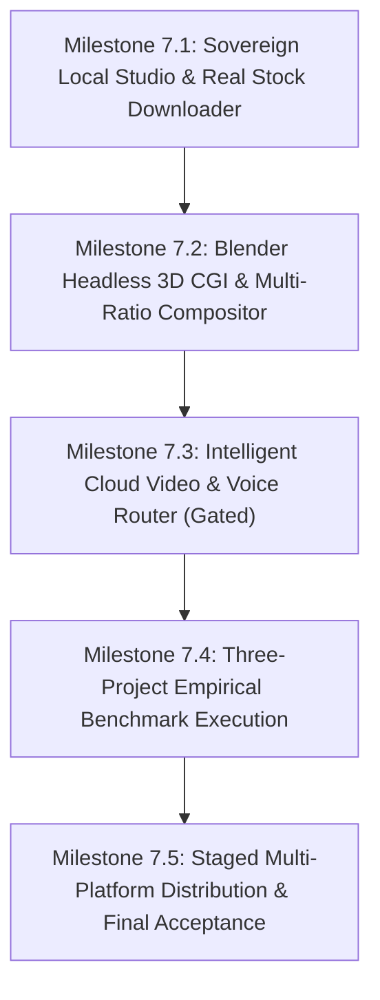

# PHASE 7.0 IMPLEMENTATION ROADMAP & ACCEPTANCE CRITERIA
## Phased Implementation Sequence, Milestones, Measurable Gates & Rollback Protocols

**Document Version:** 1.0.0-phase7.0  
**Project Root:** `F:\Master AI`  
**Target Path:** `00_CORE_SYSTEM\research\phase-7\PHASE_7_IMPLEMENTATION_ROADMAP.md`  
**Classification:** Engineering Roadmap, Execution Plan & Quality Gates  
**Status:** Approved for Review  

---

## 1. EXECUTIVE SUMMARY & SEQUENCING PRINCIPLES

Phase 7 transforms Master AI from an experimental documentary prototype into a **hardened, multi-genre cinematic AI production house**. 

To maintain system stability, the roadmap enforces strict sequencing principles:
1. **Local Sovereign Capabilities First:** Never introduce external paid cloud dependencies before the local, zero-cost pipeline is rock-solid.
2. **Deterministic Quality Gates:** Every sub-phase must pass automated unit tests, negative security tests, and media QA verification before proceeding to the next.
3. **Fail-Closed Governance:** Any unapproved spend, unverified external API claim, or unmanaged subprocess fails closed.

---

## 2. THE FIVE IMPLEMENTATION MILESTONES



---

## 3. DETAILED MILESTONE SPECIFICATIONS & ACCEPTANCE CRITERIA

### Milestone 7.1: Sovereign Local Studio & Real Stock Footage Downloader
- **Objectives:**
  1. Upgrade `PexelsMediaAdapter` and `WikimediaMediaAdapter` to perform real HTTP binary downloads of authentic 1080p wildlife footage into `16_VIDEO_LIBRARY/raw_footage/` with SHA-256 verification and genuine provenance.
  2. Implement `LemoVisualRendererAdapter` inside `09_CONTENT_STUDIO/engine/`, adapting Lemo-Opuscar's MIT-licensed Playwright-to-FFmpeg frame-piping engine.
  3. Deploy Master AI clean-room styles: `MasterAI-DarkDocumentary` and `MasterAI-Dataviz`.
  4. Deeply couple `FireRedStorylineAdapter` into `video_editor.py` so the directing plan dynamically drives cut pacing, scene durations, and audio ducking.
- **Acceptance Criteria:**
  - Real MP4 stock files downloaded and verified via SHA-256 checksums (zero mock URLs).
  - Headless Chromium frame-piping renders 1080p motion titles at >=20 FPS on host machine.
  - Directing plan parameters directly modify timeline assembly timestamps.
  - Zero modifications to existing Phase 1–5 core contracts.

### Milestone 7.2: Blender Headless 3D CGI & Multi-Ratio Compositor
- **Objectives:**
  1. Build `BlenderCGIAdapter` executing headless `blender.exe -b -P ...` via Python subprocess.
  2. Integrate glTF 2.0 asset loader and procedural camera path generator.
  3. Implement multi-aspect ratio transcoding (16:9 Landscape, 9:16 Vertical with blurred-fill, 1:1 Square).
  4. Integrate 3D LUT cinematic color grading (`lut3d` filter in FFmpeg).
- **Acceptance Criteria:**
  - Blender headless script generates a 10-second 1080p 3D animated orbit on CPU/Iris Xe in <4 minutes.
  - 9:16 vertical render outputs clean 1080x1920 video with centered subject and smooth blurred top/bottom fill.
  - 3D LUT applies without color clipping or dropped frames.

### Milestone 7.3: Intelligent Cloud Video & Voice Router (Budget Gated)
- **Objectives:**
  1. Implement universal `BaseVideoAdapter` and `BaseVoiceAdapter` interfaces.
  2. Build cloud provider adapters: Google Veo (Vertex AI), Kling AI, MiniMax Hailuo, and Sarvam AI Hindi.
  3. Integrate the Pre-Flight Cost Calculator and Circuit Breaker locking spend to `$0.00` unless authorized by an `ApprovalCenter` ticket (`TKT-*`).
  4. Implement automated fallback circuits (e.g. if Kling API times out, automatically fall back to local Blender/Stock footage).
- **Acceptance Criteria:**
  - Any request with cost > $0.00 without a ticket immediately raises `COST_APPROVAL_REQUIRED`.
  - Fallback circuit engages within 5 seconds of provider failure without aborting overall production.
  - Zero hardcoded credentials; all secrets redacted from logs and exception messages.

### Milestone 7.4: Three-Project Empirical Benchmark Execution
- **Objectives:**
  1. Execute Project A (Wildlife Documentary: "The Sovereign Lion") under local and hybrid approaches.
  2. Execute Project B (3D Scientific Explainer: "Turbofan Jet Engine") using Blender 3D CGI.
  3. Execute Project C (Cinematic Social Short: "Deep Ocean Trench") in native 9:16 vertical.
  4. Evaluate all runs against the 9-point standardized quality scorecard.
- **Acceptance Criteria:**
  - All 3 sample productions achieve **16/16 Media QA PASS**.
  - Empirical metrics recorded in `00_CORE_SYSTEM/research/phase-7/BENCHMARK_RESULTS.json`.
  - All unexecuted external tests clearly marked as `RESEARCH ESTIMATE`.

### Milestone 7.5: Staged Multi-Platform Distribution & Final Acceptance
- **Objectives:**
  1. Construct the complete `publication_bundle/` packager.
  2. Build official REST dispatchers for YouTube Data API v3, Meta Instagram Graph API, and TikTok Content Posting API v2.
  3. Enforce `ApprovalCenter` sign-off before dispatch.
  4. Run full test suite regression (all 25 test suites passing, quality gates passing).
- **Acceptance Criteria:**
  - Complete distribution package prepared with localized thumbnails, SEO metadata, and 3 video ratios.
  - Zero unauthorized public network calls.
  - Test runner exits code 0 with 100% test pass rate across all phases.

---

## 4. ROLLBACK PROTOCOL & INVARIANT CHECKLIST

If any milestone introduces unexpected instability or breaks existing Phase 1–6 functionality:
1. **Git Isolation:** All Phase 7 implementation work will occur on dedicated feature branch `phase-7.0-cinematic-studio`.
2. **Snapshot Backup:** A full zip archive of `F:\Master AI` will be created under `23_CHANGELOG_AND_BACKUP/snapshots/` before any production file is edited.
3. **Rollback Command:** In the event of an unrecoverable failure:
   ```bash
   git checkout phase-6.5-complete-ecosystem-integration
   git branch -D phase-7.0-cinematic-studio
   ```
4. **Invariant Checklist:**
   - [ ] Default project spend remains $0.00.
   - [ ] No untrusted binary executables added to repository.
   - [ ] No CC BY-NC 4.0 docs bundled into Master AI product distribution.
   - [ ] All 25 existing test suites continue to pass without regression.
