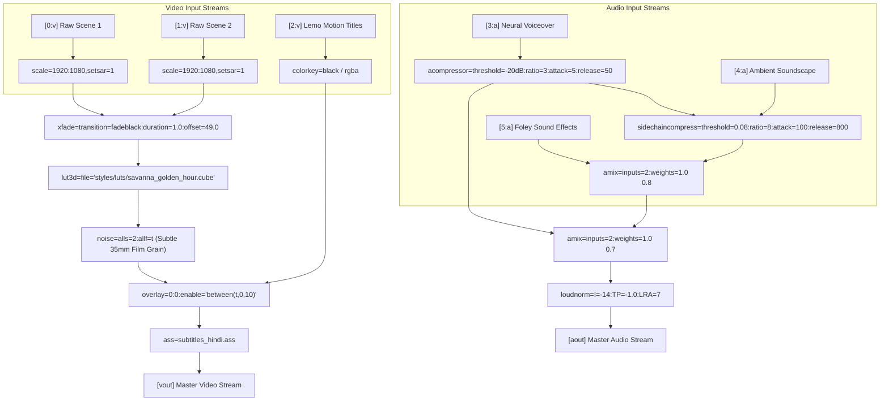

# PROFESSIONAL EDITING ARCHITECTURE & COMPOSITING PIPELINE
## FFmpeg 7.1 Complex Filtergraphs, Lemo-Opuscar Frame-Piping, Color Grading & EBU R128 Mastering

**Document Version:** 1.0.0-phase7.0  
**Project Root:** `F:\Master AI`  
**Target Path:** `00_CORE_SYSTEM\research\phase-7\PROFESSIONAL_EDITING_ARCHITECTURE.md`  
**Classification:** Technical Architecture & Video Engineering Specification  
**Status:** Approved for Review  

---

## 1. EXECUTIVE SUMMARY & COMPOSITING STRATEGY

Professional video editing is the glue that transforms disconnected AI generation clips into a cohesive cinematic experience.

Master AI's editing engine integrates four high-performance components:
1. **FFmpeg 7.1 Core:** High-throughput timeline assembly, complex multi-stream filtergraphs, hardware-accelerated color grading, and format transcoding.
2. **Lemo-Opuscar Frame-Piping Core:** Headless Playwright/Chromium engine that renders kinetic motion typography, lower thirds, chapter cards, and animated callouts directly into uncompressed frame streams.
3. **FireRed Pacing Director:** Intention-driven pacing algorithms that compute cut duration, transition selection, and rhythm based on narrative energy.
4. **EBU R128 Audio Mastering Engine:** Two-pass loudness normalization (`-14 LUFS`), true-peak limiting, and dynamic sidechain compression for vocal intelligibility.

---

## 2. MULTI-LAYER COMPOSITING FILTERGRAPH ARCHITECTURE

Every scene timeline is assembled using a deterministic, multi-input FFmpeg complex filtergraph (`-filter_complex`):



---

## 3. CINEMATIC COLOR GRADING & SHOT HARMONIZATION

AI-generated video clips from different seeds or models inevitably suffer from inconsistent white balance, contrast shifts, and color temperature drift. Master AI eliminates this through a two-step harmonization process:

### 3.1 Shot Luminance & Color Matching
Before joining scenes, clips pass through an automated color-harmonization filter:
```bash
ffmpeg -i scene_raw.mp4 -vf "eq=contrast=1.05:brightness=0.02:saturation=1.1,curves=all='0/0 0.25/0.20 0.75/0.82 1/1'" scene_matched.mp4
```

### 3.2 3D LUT Presets (`.cube`)
Master AI maintains a curated library of broadcast 3D Look-Up Tables (LUTs) in `09_CONTENT_STUDIO/engine/luts/`:
- `savanna_golden_hour.cube`: Warm amber highlights, rich earthen shadows, boosted warm foliage (Wildlife).
- `cinematic_teal_orange.cube`: Complementary skin tones, cool cinematic shadows (Narrative/Fiction).
- `bleach_bypass_contrast.cube`: Desaturated tones, harsh metallic contrast, gritty grain (Action/Industrial).
- `nocturnal_deep_blue.cube`: Deep midnight blues, crushed shadows, crisp highlights (Horror/Suspense).
- `high_key_clean_tech.cube`: Crisp neutral whites, vibrant cyan/teal accents (Science/Explainers).

Application filter:
```bash
-vf "lut3d=file='09_CONTENT_STUDIO/engine/luts/savanna_golden_hour.cube'"
```

---

## 4. AUDIO MASTERING & EBU R128 LOUDNORM SPECIFICATION

To guarantee broadcast audio compliance and eliminate harsh volume spikes or inaudible whispering, Master AI enforces the international **EBU R128 / ITU-R BS.1770-4** loudness standard:

### 4.1 Two-Pass Loudness Normalization
1. **Target Integrated Loudness:** `-14.0 LUFS` (optimal for YouTube, Spotify, and social streaming).
2. **True Peak Ceiling:** `-1.0 dBTP` (prevents clipping during lossy AAC/MP3 transcoding).
3. **Loudness Range (LRA):** `7.0 LU` (ensures cinematic dynamics while retaining vocal clarity).

```bash
ffmpeg -i master_mix.wav -af "loudnorm=I=-14:TP=-1.0:LRA=7:print_format=json" -f null -
# Second pass applies measured integrated loudness, true peak, and offset parameters
ffmpeg -i master_mix.wav -af "loudnorm=I=-14:TP=-1.0:LRA=7:measured_I=-18.2:measured_TP=-0.4:measured_LRA=9.1:measured_thresh=-28.5:linear=true" master_mastered.wav
```

### 4.2 Dynamic Vocal Sidechain Ducking
When narration plays, background music and ambient drones automatically attenuate by **-14 dB to -18 dB**:
- **Attack Time:** `100 ms` (gradual, imperceptible fade-down as speech begins).
- **Release Time:** `800 ms` (smooth, natural swell back to full volume after speech ends).
- **Threshold:** `0.08` (triggers on vocal presence without pumping during room breaths).

---

## 5. SUBTITLE STYLING & ANIMATED ADVANCED SUBSTATION ALPHA (.ASS)

Plain SRT subtitles lack styling, positioning, and kinetic emphasis. Master AI compiles speech timestamps into styled **ASS (Advanced SubStation Alpha)** subtitles:

### 5.1 ASS Style Template
```ini
[Script Info]
ScriptType: v4.00+
PlayResX: 1920
PlayResY: 1080

[V4+ Styles]
Format: Name, Fontname, Fontsize, PrimaryColour, SecondaryColour, OutlineColour, BackColour, Bold, Italic, Underline, StrikeOut, ScaleX, ScaleY, Spacing, Angle, BorderStyle, Outline, Shadow, Alignment, MarginL, MarginR, MarginV, Encoding
Style: MasterAI_Hindi,Noto Sans Devanagari,54,&H00FFFFFF,&H000000FF,&H00000000,&H80000000,1,0,0,0,100,100,0,0,1,3,2,2,40,40,65,1
Style: MasterAI_English,Montserrat,46,&H00E0E0E0,&H000000FF,&H00101010,&H80000000,1,0,0,0,100,100,1,0,1,2,2,2,40,40,30,1
```

- **Devanagari Font:** `Noto Sans Devanagari` (guarantees zero character clipping or missing glyph boxes on Windows 11).
- **Positioning:** Centered at bottom (`Alignment: 2`, `MarginV: 65px`), leaving clear safety space above platform UI controls.
- **Visual Contrast:** Pure white text with 3px black outline and 2px drop shadow, readable across both bright desert sands and dark nocturnal scenes.

---

## 6. MULTI-ASPECT RATIO TRANSCODING (16:9, 9:16, 1:1)

Master AI produces three platform-optimized variants from a single production:

| Format | Target Platforms | Dimensions | Framing Strategy |
| :--- | :--- | :--- | :--- |
| **16:9 Widescreen** | YouTube, Web, Television | `1920x1080` / `3840x2160` | Full native cinematic framing with original composition. |
| **9:16 Vertical** | YouTube Shorts, TikTok, Instagram Reels | `1080x1920` | Dynamic intelligent crop or blurred background split: central 1080x1080 subject with duplicated, blurred top/bottom video fill. |
| **1:1 Square** | Instagram Feed, LinkedIn, X | `1080x1080` | Center-weighted crop with top-aligned subtitles. |

### 9:16 Blurred-Fill Filtergraph
```bash
ffmpeg -i master_16x9.mp4 -filter_complex \
"[0:v]scale=1080:1920:force_original_aspect_ratio=increase,crop=1080:1920,boxblur=20:5[bg]; \
 [0:v]scale=1080:608:force_original_aspect_ratio=decrease[fg]; \
 [bg][fg]overlay=(W-w)/2:(H-h)/2[v]" \
-map "[v]" -map 0:a -c:v libx264 -c:a copy render_9x16_vertical.mp4
```
This guarantees that 16:9 cinematic footage is instantly reusable on TikTok and Shorts without clumsy black letterboxing or severe edge cropping.
