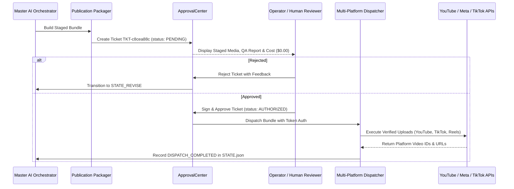

# SOCIAL DISTRIBUTION ARCHITECTURE & MULTI-PLATFORM PUBLISHING
## Real API Constraints, OAuth Requirements, Quotas, Staging Gating & Socialdrop Analysis

**Document Version:** 1.0.0-phase7.0  
**Project Root:** `F:\Master AI`  
**Target Path:** `00_CORE_SYSTEM\research\phase-7\SOCIAL_DISTRIBUTION_ARCHITECTURE.md`  
**Classification:** Operational Security, API Engineering & Distribution Architecture  
**Status:** Approved for Review  

---

## 1. EXECUTIVE SUMMARY & DISTRIBUTION SAFETY INVARIANT

Automated social publishing without human review poses severe risks of copyright strikes, account suspensions, and accidental data exposure.

Master AI establishes a **Strict Two-Tier Distribution Architecture**:
1. **Tier 1: Staging & Dry-Run Packaging (Fully Autonomous):** Master AI transcodes platform-specific video ratios (16:9, 9:16, 1:1), renders localized thumbnails, formats SEO tags, writes `PUBLICATION_METADATA.json`, and submits a formal ticket (`TKT-*`) to the `ApprovalCenter`.
2. **Tier 2: Public Dispatch (Human-Authorized Only):** Zero public posts may occur without an authorized approval ticket signed by the operator. Automated un-gated broadcasting is prohibited by code invariant.

---

## 2. OFFICIAL PLATFORM APIS: REALITY, LIMITS & OAUTH REQUIREMENTS

| Platform | Official API Endpoint | Account Eligibility | Video Ingestion Method | Daily Quota Limits | OAuth 2.0 Scopes & App Review |
| :--- | :--- | :--- | :--- | :--- | :--- |
| **YouTube** (Longs & Shorts) | YouTube Data API v3 (`videos.insert`) | Any Google Account with YouTube Channel | Resumable chunked binary upload via HTTP POST | **10,000 units/day** default (`videos.insert` = 1,600 units → **max ~6 videos/day**) | `youtube.upload`, `youtube.readonly`. Unverified app restricted to `private` uploads. |
| **Instagram** (Reels & Feed) | Instagram Graph API (`/media`, `/media_publish`) | **Business or Creator Account Only** (Personal blocked) | Asynchronous pull: API requires **publicly accessible HTTPS URL** | **50 posts / 24 hours** per account | `instagram_content_publish`. App requires Meta App Review + Business Verification. |
| **Facebook** (Reels & Page Video) | Facebook Graph API (`/{page-id}/videos`) | Facebook Page Admin / Business Page | Direct chunked upload or HTTPS URL pull | Standard Graph rate limits (200 calls/hr/user) | `pages_manage_posts`, `pages_read_engagement`. App Review required. |
| **TikTok** (Shorts & Feed) | TikTok Content Posting API v2 | TikTok Creator / Business Account | Chunked binary upload via Direct Post API | Rate limited per user (~10 posts/day) | `video.upload`, `video.publish`. Strictly requires Developer App Review. |
| **X (Twitter)** (Feed Video) | X API v1.1 / v2 (`media/upload.json`) | X Developer Account (Basic tier: $100/mo) | Chunked multipart upload (`INIT`, `APPEND`, `FINALIZE`) | Free tier: **Blocked for video**. Basic tier: Max 512 MB, **140s max duration**. | OAuth 1.0a / OAuth 2.0 User Context (`tweet.write`, `media.write`). |
| **LinkedIn** (Feed Video) | LinkedIn REST API (`/rest/videos`) | LinkedIn Member or Company Page Admin | Two-step: `initializeUpload` → chunked PUT | 100 uploads/day per organization | `w_member_social`, `w_organization_social`. Standard Developer Portal access. |

---

## 3. EVALUATION OF SOCIALDROP ADAPTER

Phase 6.5 integrated `socialdrop` (`https://github.com/socialdrop/socialdrop`) via `10_SOCIAL_MEDIA/publishers/socialdrop_adapter.py`:

### Strengths
- Provides clean, unified JSON manifests specifying platform title lengths, description character limits, and tag formatting.
- Native support for dry-run simulation, allowing Master AI to test metadata packaging locally without connecting real OAuth tokens.

### Limitations & Required Hardening
- `socialdrop` is primarily a CLI wrapper. For enterprise stability, Master AI must not rely on third-party headless web scrapers or unofficial browser sessions.
- All real publishing must route through official REST APIs utilizing official client secrets and secure token storage.
- Instagram's requirement for a publicly accessible HTTPS video URL means that local-only files cannot be pushed to Instagram directly without a temporary signed cloud staging bucket (e.g. Google Cloud Storage or AWS S3 signed URL).

---

## 4. THE STAGED PUBLICATION PACKAGE STRUCTURE

Every completed project seals its distribution assets in a standardized publication directory:

```
09_CONTENT_STUDIO/documentaries/DOC-26c9a068/
├── publication_bundle/
│   ├── PUBLICATION_METADATA.json        (Master manifest: titles, descriptions, tags, platform mapping)
│   ├── render_16x9_youtube_1080p.mp4    (Landscape master for YouTube long-form)
│   ├── render_9x16_shorts_1080p.mp4     (Vertical master for YouTube Shorts, TikTok, Reels)
│   ├── render_1x1_feed_1080p.mp4        (Square master for Instagram Feed & LinkedIn)
│   ├── thumbnail_youtube_1280x720.png   (High-CTR YouTube thumbnail)
│   ├── thumbnail_vertical_1080x1920.png (Cover image for vertical platforms)
│   ├── subtitles_multilingual/          (Devanagari, English, and Spanish SRT/ASS files)
│   └── TKT-APPROVAL-REQUEST.json        (Approval ticket with checksums and reviewer sign-off block)
```

---

## 5. APPROVAL CENTER & DISPATCH LIFECYCLE



### Safety Rules Enforced by Code
1. `Dispatcher.execute()` verifies that `ticket.status == "AUTHORIZED"` and `ticket.signature` is valid.
2. If credentials are missing, the dispatcher creates a local upload instruction shell script (`upload_manual.sh`) allowing the user to inspect and upload manually using official CLIs.
3. Network calls to public APIs occur strictly within the dispatcher module; no core agent or adapter makes background social posts.
