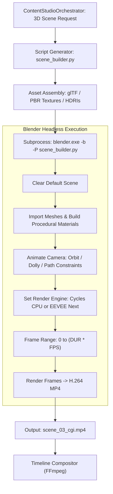

# 3D CGI ANIMATION ENGINE COMPARISON & WORKFLOW PLAN
## Blender Automation, Unreal Engine, Procedural Geometry & AI 3D Mesh Generation

**Document Version:** 1.0.0-phase7.0  
**Project Root:** `F:\Master AI`  
**Target Path:** `00_CORE_SYSTEM\research\phase-7\THREE_D_CGI_ENGINE_COMPARISON.md`  
**Classification:** Research, Engine Evaluation & Hardware Feasibility  
**Status:** Approved for Review  

---

## 1. EXECUTIVE SUMMARY & OBJECTIVE

A core requirement of Master AI Phase 7.0 is distinguishing **photorealistic generative AI video** from **genuine, editable 3D CGI animation**:
- Generative AI video outputs a flat 2D raster video stream (`.mp4`) where cameras, lights, and geometry cannot be modified after generation.
- A 3D CGI Engine generates true geometric scenes with real meshes, vertices, bones, PBR materials, virtual cameras, and physics simulations.

This report evaluates how Master AI can programmatically generate, rig, light, and render true 3D scenes using headless automation on our Windows 11 host (Intel Core i5-1245U, 32 GB RAM, Intel Iris Xe graphics), while establishing clear boundaries for when rendering must transition to cloud GPU farms.

---

## 2. 3D ENGINE EVALUATION: BLENDER VS. UNREAL ENGINE

| Evaluation Dimension | Blender 4.x (`bpy` Python API) | Unreal Engine 5.x (Movie Render Queue) |
| :--- | :--- | :--- |
| **Automation Interface** | Native Python (`bpy`) built into Blender binary | Python wrapper over C++ Unreal Engine Editor |
| **Headless CLI Execution** | **Flawless:** `blender.exe -b -P scene_builder.py -o out.mp4 -a` | **Complex:** Requires Editor startup, project assets, and D3D12 GPU |
| **Disk Space Footprint** | **~800 MB** total download and install | **120+ GB** for engine, shaders, and project cache |
| **Hardware Requirement** | Runs on **pure CPU** (Intel Embree + Open Image Denoise) | Strictly requires **dedicated DirectX 12 GPU** (RTX 3070+) |
| **Iris Xe Compatibility** | **100% Compatible** (EEVEE Next / Cycles CPU) | **Incompatible / Crashes** (Insufficient VRAM & compute units) |
| **Rendering Performance** | Cycles CPU: 15–45s/frame (1080p). EEVEE: 1–3s/frame. | Real-time Lumen / MRQ: 10–60s/frame on RTX 4090 |
| **Format Interoperability** | glTF 2.0, USD, FBX, OBJ, Alembic, STL | USD, FBX, Alembic, Datasmith |
| **Licensing** | **GNU GPL v3** (Zero commercial royalties) | **Unreal EULA** (Royalty-free under $1M gross revenue) |
| **Host Suitability Verdict** | **PRIMARY LOCAL PRODUCTION ENGINE (100% VIABLE)** | **REMOTE CLOUD GPU ONLY (NOT VIABLE LOCALLY)** |

### Architectural Conclusion
Blender 4.x is the definitive local 3D engine for Master AI. It requires zero license fees, installs in under 1 GB, integrates seamlessly with our Python 3.14 orchestrator via subprocess, and renders reliably on the Intel Core i5-1245U using Intel-optimized CPU ray tracing (Embree + OIDN). Unreal Engine is reserved exclusively for optional high-end remote cloud instances.

---

## 3. BLENDER HEADLESS AUTOMATION ARCHITECTURE (`BlenderCGIAdapter`)

Master AI orchestrates Blender programmatically by generating modular Python build scripts (`scene_builder.py`) and executing them in background headless mode:



### 3.1 Sample Headless Scene Builder Pattern
```python
# scene_builder.py - Executed internally by Blender Python
import bpy
import math

# 1. Reset scene to pristine state
bpy.ops.wm.read_factory_settings(use_empty=True)
scene = bpy.context.scene

# 2. Setup resolution and timeline
scene.render.resolution_x = 1920
scene.render.resolution_y = 1080
scene.render.fps = 30
scene.frame_start = 1
scene.frame_end = 150  # 5 seconds @ 30 FPS

# 3. Configure CPU-optimized Cycles raytracing
scene.render.engine = 'CYCLES'
scene.cycles.device = 'CPU'
scene.cycles.threads_mode = 'FIXED'
scene.cycles.threads = 8  # Leave 2 cores for OS responsiveness
scene.cycles.samples = 64
scene.cycles.use_denoising = True
scene.cycles.denoiser = 'OPENIMAGEDENOISE'

# 4. Import 3D subject asset (glTF 2.0)
bpy.ops.import_scene.gltf(filepath="assets/models/lion_anatomical.glb")
subject = bpy.context.selected_objects[0]

# 5. Create cinematic keyframed camera movement (cinematic dolly-zoom)
cam_data = bpy.data.cameras.new("CinematicCamera")
cam_data.lens = 50.0  # 50mm portrait lens
cam_obj = bpy.data.objects.new("CinematicCamera", cam_data)
scene.collection.objects.link(cam_obj)
scene.camera = cam_obj

cam_obj.location = (0, -6, 1.8)
cam_obj.rotation_euler = (math.radians(75), 0, 0)
cam_obj.keyframe_insert(data_path="location", frame=1)

cam_obj.location = (0, -3.5, 1.2)
cam_obj.keyframe_insert(data_path="location", frame=150)

# 6. Render video directly to broadcast H.264 MP4
scene.render.image_settings.file_format = 'FFMPEG'
scene.render.ffmpeg.format = 'MPEG4'
scene.render.ffmpeg.codec = 'H264'
scene.render.filepath = "renders/scene_03_cgi.mp4"
bpy.ops.render.render(animation=True)
```

---

## 4. AI-GENERATED 3D ASSETS & PIPELINES

To eliminate manual 3D modeling, Master AI connects to modern open-weights and API-based 3D mesh generation pipelines:

| Model / Service | Input Type | Output Format | Topology & Materials | Generation Time | Local / Cloud |
| :--- | :--- | :--- | :--- | :--- | :--- |
| **Microsoft Trellis** | Single Image / Multi-view | `.glb` (glTF 2.0) with PBR | High-resolution Gaussian / Mesh with normal maps | ~20–40s | Cloud GPU / Local (24GB VRAM) |
| **Tripo3D API** | Text or Image | `.glb`, `.fbx`, `.obj` | Clean quad-like retopology, full PBR textures | ~15–30s | Cloud API (~$0.10/model) |
| **Meshy.ai API** | Text or Image | `.glb`, `.usdz` | Textured game-ready mesh, auto-rigging | ~45–60s | Cloud API (~$0.15/model) |
| **InstantMesh** | Single Image | `.obj`, `.glb` | Raw surface reconstruction, vertex colors | ~10s | Cloud GPU (Modal / RunPod) |
| **Poly Haven Archive** | Curated CC0 Library | `.gltf`, `.blend` | Broadcast-grade manual geometry, 4K PBR | Instant (Download) | **Local Offline (Free)** |

### Master AI Hybrid 3D Strategy
1. **Tier 1 (Instant Offline CC0):** Query Master AI's local curated archive of Poly Haven / ambientCG 3D assets (furniture, foliage, terrain, anatomical primitives) for instant zero-cost assembly.
2. **Tier 2 (AI Image-to-3D):** For unique custom subjects, generate a crisp multi-angle reference image using Image AI, then dispatch to Trellis or Tripo3D API to generate a textured `.glb` model.
3. **Tier 3 (Automated Rigging):** Apply Mixamo / AccuRig automated skeletal bone binding for animated human/animal subjects.

---

## 5. DECISION MATRIX: WHEN TO USE 3D CGI VS. GENERATIVE AI VIDEO

| Project Requirement | Recommended Visual Engine | Technical Rationale |
| :--- | :--- | :--- |
| **Scientific & Astronomical Explanations** | **Blender 3D CGI** | Planetary orbits, atomic structures, and physics simulations require mathematical precision that generative video hallucinates. |
| **Architectural & Product Flythroughs** | **Blender 3D CGI** | Straight lines, geometric dimensions, and exploded component views must remain geometrically rigid across camera cuts. |
| **Wildlife Documentary Narration** | **Generative AI Video (Veo/Kling)** | Biological realism (fur dynamics, muscle twitches, atmospheric lighting) is orders of magnitude more convincing in generative video than low-budget CGI. |
| **Cinematic Storytelling & Human Drama** | **Generative AI Video (Runway/Kling)** | Emotional human micro-expressions and dynamic cinematic lighting are best achieved via Image-to-Video models. |
| **Data Visualization & Telemetry Charts** | **Lemo-Opuscar / 2D Canvas** | 2D vector typography and SVG motion are faster and sharper than 3D rendering for on-screen metrics. |
| **Hybrid Sequences (e.g. Lion Habitat Map)** | **Blender CGI (Map) + AI Video (Lions)** | Render 3D terrain flyover in Blender, then cut to photorealistic AI video of lions resting on the ground. |
