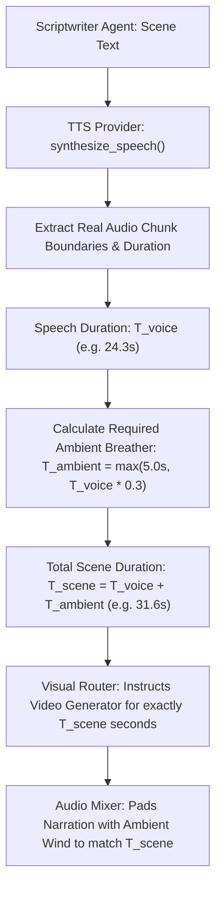

# VOICE AND AUDIO PROVIDER COMPARISON & SOUND DESIGN ENGINE
## Neural TTS Engines, Indian Language Specialists, Music Generation & Procedural Audio

**Document Version:** 1.0.0-phase7.0  
**Project Root:** `F:\Master AI`  
**Target Path:** `00_CORE_SYSTEM\research\phase-7\VOICE_AND_AUDIO_PROVIDER_COMPARISON.md`  
**Classification:** Research, Provider Benchmark & Audio Engineering Architecture  
**Status:** Approved for Review  

---

## 1. EXECUTIVE SUMMARY & AUDIO HIERARCHY

A cinematic production requires three synchronized acoustic layers:
1. **The Vocal Core:** Highly articulate, emotionally modulated neural narration with native pronunciation across Hindi, English, and global languages.
2. **The Musical Score:** Thematic background composition that builds narrative tension, underscores scene transitions, and ducks dynamically behind speech.
3. **The Foley & Environmental Soundscape:** Tactile sound effects (footsteps, roaring, wind rustle, whooshes) aligned frame-by-frame with on-screen action.

Master AI strictly prohibits accepting procedural harmonic sound or robotic SAPI audio as human speech. This report benchmarks top-tier voice providers and designs the unified `VoiceAndAudioEngine`.

---

## 2. MULTILINGUAL & HINDI TTS PROVIDER BENCHMARK

| Provider / Model | Hindi Linguistic Fidelity | Emotional & Pacing Control | Voice Cloning / Identity | Official API Availability | Pricing (Estimated) | Host Python 3.14 Readiness | Master AI Role |
| :--- | :--- | :--- | :--- | :--- | :--- | :--- | :--- |
| **Microsoft Edge TTS** (`hi-IN-MadhurNeural`) | **High (Native Devanagari)** | Moderate (via SSML rate/pitch) | No (Pre-built voices) | Online WebSocket (Sec-MS-GEC v2) | **$0.00 (Zero-Cost)** | **100% Ready (Active)** | **Default Sovereign Hindi Voice** |
| **Sarvam AI** (`Bulbul v1 / Mayura`) | **Exceptional (SOTA Indian Nuance)** | High (Indian dialects & pacing) | Yes (Planned) | Official REST API (`api.sarvam.ai`) | **~$0.002 / min** (₹0.15/min) | **100% Ready (REST API)** | **Flagship Indian Language Engine** |
| **ElevenLabs** (`Multilingual v2`) | **Very High** | **Exceptional (Prosody & Drama)**| **Yes (Instant & Professional)**| Official Python SDK / REST | **$0.15 – $0.30** / 1k chars | **100% Ready (REST API)** | **Premium Cinematic Narratives** |
| **Cartesia** (`Sonic Multilingual`) | High | High (Ultra-low latency ~100ms) | Yes | WebSocket / REST | **$0.05** / 1k chars | **100% Ready (REST API)** | **Real-Time Interactive Narration** |
| **OpenAI TTS** (`tts-1-hd`) | Moderate | Moderate (Neutral delivery) | No | OpenAI API / Python SDK | **$0.030** / 1k chars | **100% Ready (REST API)** | **Secondary Cloud Fallback** |
| **Kokoro ONNX** (Open-Weights) | Untested in Hindi (English/Chinese) | High (Clean phonetics) | No | Open Weights (Apache 2.0) | **$0.00 (Local)** | **INCOMPATIBLE (Needs 3.11–3.13)**| **Excluded until Python 3.14 wheel** |
| **Windows SAPI5** (Local OS) | **Incompatible (No Hindi voice pack)**| Zero (Robotic legacy speech) | No | Local COM Dispatch (`win32com`) | **$0.00 (Local)** | **100% Ready (English only)**| **Emergency English Offline Only** |

### Strategic Voice Routing Hierarchy
- **Zero-Paid Default:** Microsoft Edge TTS (`hi-IN-MadhurNeural` for male narration, `hi-IN-SwaraNeural` for female narration). It delivers broadcast-quality neural Hindi speech with zero operational cost and full sentence boundary metadata.
- **Flagship Indian Productions:** Sarvam AI (`Bulbul`). Provides unparalleled phonetic authenticity for Devanagari Hindi, Marathi, Tamil, and Bengali dialects.
- **Cinematic Drama & Voice Cloning:** ElevenLabs (`Multilingual v2`). Utilized when explicit dramatic emotion (whispering, breathless suspense, booming proclamation) is required.

---

## 3. VOCAL TIMING & SCENE SYNCHRONIZATION ALGORITHM

A critical defect in naive video generators is fixing visual scene duration (e.g. 10.0s) and then truncating or stretching audio to fit. Master AI enforces **Voice-Driven Timeline Pacing**:



### Mathematical Invariants
1. `T_scene >= T_voice + 4.0s`: A scene must never cut off immediately as the narrator finishes speaking; it must breathe for at least 4.0 seconds on ambient soundscape.
2. `L_subtitle_window <= T_sentence`: Subtitles appear at `offset` and disappear at `offset + duration + 0.3s`, preventing overlapping subtitle collisions.

---

## 4. SOUND DESIGN & MUSIC GENERATION HIERARCHY

Master AI constructs its musical and foley layer using a three-tier architecture:

```
┌────────────────────────────────────────────────────────────────────────┐
│                        AUDIO ARCHITECTURE TIERS                        │
├────────────────────────────────────────────────────────────────────────┤
│ 1. THEMATIC MUSICAL SCORE                                              │
│    • Meta MusicGen (Cloud GPU / Modal): 30s text-to-music loops       │
│    • Curated CC0 Cinematic Archive: 50+ lossless orchestral tracks     │
│    • Volume Profile: -18 LUFS (ducks to -32 LUFS during speech)        │
├────────────────────────────────────────────────────────────────────────┤
│ 2. ENVIRONMENTAL AMBIENT SOUNDSCAPES                                   │
│    • Natural Wind, Rain, Jungle, Savanna Night Pink-Noise Textures     │
│    • Continuous 300s Bed: Prevents 'dead air' silence between scenes    │
│    • Volume Profile: -24 LUFS                                          │
├────────────────────────────────────────────────────────────────────────┤
│ 3. FOLEY & TACTILE SOUND EFFECTS                                       │
│    • Lemo-Opuscar sfx.py (Procedural filters, whooshes, clicks, thumps)│
│    • FreeSound CC0 Library: Roars, water splashes, footsteps           │
│    • Timecode-aligned to visual motion events via window.EV metadata   │
└────────────────────────────────────────────────────────────────────────┘
```

---

## 5. INDEPENDENT ASR VERIFICATION & QUALITY GATING

Before any production is certified, Master AI runs the final mixed soundtrack through an automated speech intelligibility audit using local `faster-whisper` (CPU INT8):

1. **Transcription:** Extracts all spoken segments with timestamps and confidence scores.
2. **Levenshtein Similarity & Word Error Rate (WER):**
   $$\text{Similarity} = 1.0 - \frac{\text{LevenshteinDistance}(\text{Script}, \text{ASR})}{\max(\text{len}(\text{Script}), \text{len}(\text{ASR}))}$$
3. **Threshold Gate:**
   - `Similarity >= 0.85`: **PASS**.
   - `0.70 <= Similarity < 0.85`: **WARNING** (flagged for human review).
   - `Similarity < 0.70`: **FAIL-CLOSED** (triggers automatic re-synthesis with slower speaking rate).
4. **Hallucination Detection:** If ASR segments repeat the same token >3 times, or if words appear that have zero phonetic overlap with the script, the audit marks the voice track as defective.
