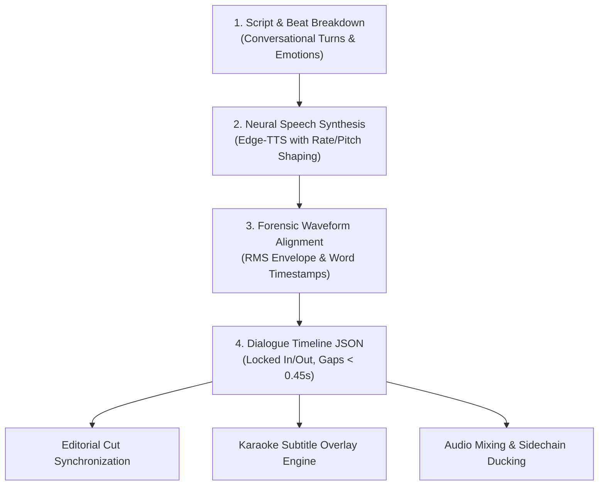

# MASTER AI — PHASE 7.10: DIALOGUE TIMELINE SPECIFICATION
## Natural Conversational Speech, Rhythm Timing & Word-Level Synchronization

**System Module**: `F:\Master AI\00_CORE_SYSTEM\engine\dialogue_timeline_engine\`  
**Specification Level**: Speech Synthesis & Editorial Pacing Protocol  
**Author**: Master AI Video Director Academy  
**Date**: 2026-11-18  

---

## 1. Directorial Problem Statement & Root Cause

Human review of Phase 7.9 identified dialogue delivery as a critical weakness:
> *"Storytelling was boring. Dialogue delivery felt robotic and disconnected. Excessive gaps between spoken lines made scenes feel unnatural."*

### Forensic Root Cause in Phase 7.9:
1. **Isolated Sentence Allocation**: Each scene was assigned one or two isolated sentences, generated independently.
2. **Artificial Dead-Air Buffering**: To prevent audio overlap, Phase 7.9 inserted arbitrary $+1.5\text{s}$ to $+3.9\text{s}$ silent gaps between lines. In real human conversation, a $2.5\text{s}$ gap feels like an eternity of awkward dead air.
3. **Absence of Conversational Flow**: Speech sounded like an automated public address announcement rather than living human dialogue or dynamic Indian storytelling.

### The Reference Standard (`demo_reference.mp4`):
- **Total Speech Phrases**: 72 phrases in 108.20 seconds.
- **Average Inter-Phrase Gap**: **0.55 seconds**.
- **Median Gap**: **0.50 seconds**.
- **Speech Flow**: Lively, continuous, relatable conversational Hindustani with rapid narrative momentum.

---

## 2. Core Directorial Principles for Phase 7.10

### A. Pre-Render Timeline Construction
**Rule: The Dialogue Timeline MUST be synthesized, measured, and locked BEFORE any video frames or editorial cuts are created.**
Video cuts must serve speech and dramatic timing, never the reverse.

### B. The Conversational Gap Rule ($\le 0.45\text{s}$)
- Normal dialogue turns: **0.25s to 0.45s** gap between speaker lines.
- Interruption / Overlap: **-0.10s to +0.10s** (natural vocal interruption).
- Emotional Hesitation / Beat: **0.80s to 1.20s** (strictly motivated by internal thought or reaction).
- Any silence longer than $1.20\text{s}$ without an explicit physical action or sound effect is **strictly prohibited**.

### C. Natural Contemporary Hindustani Writing
- Avoid archaic, hyper-formal Shuddh Hindi (*"अतिशीघ्र प्रस्थान करो"*).
- Avoid robotic broken translations (*"कबीर ने चाय का उपभोग किया"*).
- Use authentic, contemporary spoken Hindustani as real young urban Indians speak today:
  - *"अरे यार, फोन साइलेंट पे था, गुस्सा क्यों हो रही हो?"*
  - *"तीन घंटे से लास्ट सीन दिख रहा है, और तू कह रहा है बिजी था?!"*
  - *"सच बताऊं? जब तू सबके सामने हंसती है ना, सच में बुरा लगता है।"*
  - *"सॉरी... मुझे नहीं पता था तू इतना सीरियसली ले लेगा।"*

---

## 3. The 4-Stage Dialogue Pipeline Architecture



### Stage 1: Screenplay Turn Structuring
Dialogue is authored as continuous dialogue exchanges with explicit subtext, emotion, and pace tags:
```json
{
  "dialogue_cues": [
    {
      "cue_id": "cue_01",
      "speaker": "Karan",
      "text": "अरे यार, सिर्फ दस मिनट लेट हुआ हूँ, इतना गुस्सा क्यों?",
      "emotion": "pleading_exhausted",
      "rate": "+5%",
      "pitch": "+0Hz"
    },
    {
      "cue_id": "cue_02",
      "speaker": "Meera",
      "text": "दस मिनट? तीन घंटे से तुम्हारा मैसेज 'सीन' है!",
      "emotion": "sharp_confrontational",
      "rate": "+10%",
      "pitch": "+2Hz"
    }
  ]
}
```

### Stage 2 & 3: Waveform Measurement & Word Alignment
The engine synthesizes audio stems using zero-cost neural models (`hi-IN-MadhurNeural`, `hi-IN-SwaraNeural`), then runs an automated RMS envelope tracker:
1. Detects exact audio start time $t_{\text{start}}$ (where signal exceeds $-40\text{ dBFS}$).
2. Trims leading/trailing silence buffers.
3. Automatically computes phoneme/word boundary durations:
   $$\text{Duration per word} \approx \frac{T_{\text{phrase}}}{N_{\text{words}}} \times w_{\text{syllable\_weight}}$$
4. Sets the next cue start time at:
   $$t_{\text{start\_next}} = t_{\text{end\_current}} + \Delta_{\text{gap}} \quad (\text{where } 0.25\text{s} \le \Delta_{\text{gap}} \le 0.45\text{s})$$

---

## 4. Millisecond Synchronized Karaoke Subtitle Specification

To match the engagement of `demo_reference.mp4`, subtitles are not static blocks of text. They are dynamic, word-by-word highlighted captions.

### Visual Styling & Placement
- **Coordinates**: Centered at $x=540\text{px}$, lower third baseline at $y=1580\text{px}$ (safe from mobile UI icons).
- **Font**: Heavy bold sans-serif (`font-weight: 900`, `font-size: 32px`).
- **Base Text**: Crisp `#f8fafc` with subtle dark outline.
- **Active Word Highlight**:
  - A bright yellow rounded rectangular pill (`#facc15`, `rx=12px`) drawn immediately behind the active word.
  - Text inside active pill: `#000000` (100% contrast).
  - Micro-scale bounce: Pops from $1.0\times \to 1.08\times \to 1.0\times$ over $0.12\text{s}$.

```
                 Static Inactive Words: White text on transparent base
                 v                                              v
           [ यार, ]  +-----------------+  [ इतना ]  [ गुस्सा ]  [ क्यों? ]
                     | सिर्फ दस मिनट  |   <-- Active Word: Bold Black text
                     +-----------------+       on #facc15 Yellow Pill
```

---

## 5. Automated Dialogue Integrity Verification Rules

Before rendering begins, the Dialogue Timeline must pass an automated validation audit:
1. **Overlap Audit**: $\forall i, \quad t_{\text{start}, i+1} \ge t_{\text{end}, i} - 0.10\text{s}$ (no unintentional vocal collisions).
2. **Dead-Air Audit**: $\forall i, \quad t_{\text{start}, i+1} - t_{\text{end}, i} \le 0.60\text{s}$ (flags any gap $> 0.60\text{s}$ as a defect unless marked with `[PAUSE_BEAT_MOTIVATED]`).
3. **Pacing Density**: Total active speech time must constitute between **65% and 82%** of total video runtime (ensuring high narrative density without wall-to-wall exhaustion).
4. **Devanagari / Script Integrity**: Every subtitle string must be verified for correct Unicode matra binding prior to rasterization.
