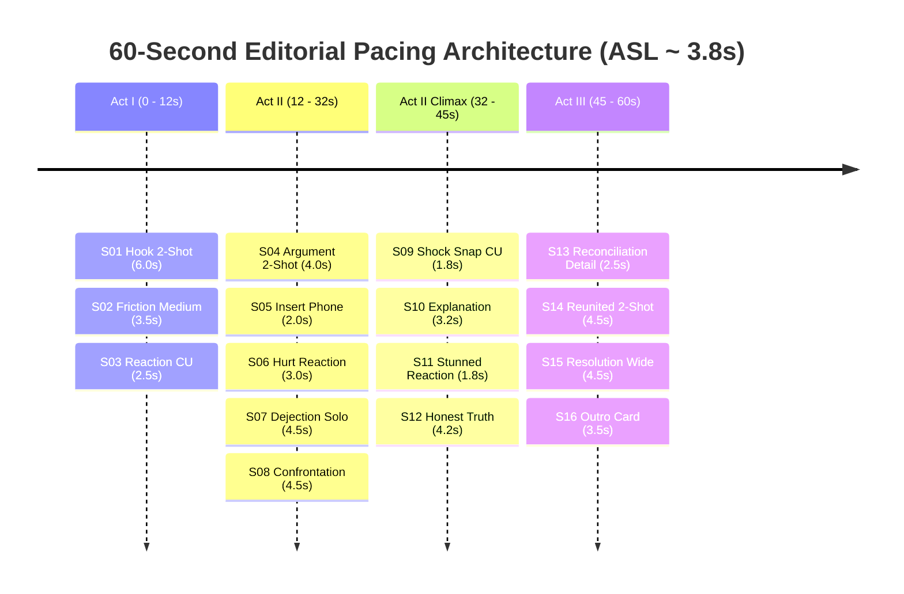

# MASTER AI — PHASE 7.10: EDITORIAL ENGINE SPECIFICATION
## Autonomous Cinematic Cutting, Pacing Rhythm & Shot Composition

**System Module**: `F:\Master AI\00_CORE_SYSTEM\engine\editorial_engine\`  
**Specification Level**: Master Directorial Ruleset  
**Author**: Master AI Video Director Academy  
**Date**: 2026-11-18  

---

## 1. Directorial Mandate: The Reference Standard

Human feedback on Phase 7.9 revealed a core flaw: the film had only **8 uniform shots across 60 seconds**, averaging **7.50 seconds per shot**. This metronome monotony caused the video to feel slow, amateurish, and visually boring.

In contrast, our forensic analysis of the professional benchmark (`demo_reference.mp4`) demonstrated:
- **Total Shots**: 23 shots across 108.20 seconds.
- **Average Shot Length (ASL)**: **4.70 seconds**.
- **Median Shot Length**: **3.93 seconds**.
- **Climax Reaction Shots**: **1.50 seconds to 2.70 seconds**.
- **Cut Frequency**: **12.75 cuts per minute**.

Phase 7.10 mandates that the Editorial Engine enforce **dynamic cinematic cutting with an ASL target between 3.5s and 4.8s**, employing standard film grammar (shot/reverse-shot, reaction cuts, insert details, motivated cuts).

---

## 2. Shot Classification & Scale Taxonomy

The Editorial Engine operates across five standardized camera framings:

```
+-------------------------------------------------------------------+
| 1. WIDE SHOT (WS)                                                 |
|    - Establishes full environment, room geography, multiple actors |
|    - Typical Duration: 5.0s – 8.0s (Opening / Ending)             |
+-------------------------------------------------------------------+
| 2. MEDIUM 2-SHOT (M2S)                                            |
|    - Both primary characters visible from waist up                |
|    - Establishes interpersonal tension, dialogue exchange         |
|    - Typical Duration: 3.5s – 5.5s                                |
+-------------------------------------------------------------------+
| 3. MEDIUM SHOT (MS)                                               |
|    - Single character from waist up                               |
|    - Highlights gestures, body language, posture shifts           |
|    - Typical Duration: 3.0s – 4.5s                                |
+-------------------------------------------------------------------+
| 4. CLOSE-UP (CU)                                                  |
|    - Character from chest/shoulders up                            |
|    - Focuses purely on facial expression, eyebrows, eye direction |
|    - Typical Duration: 2.0s – 3.5s                                |
+-------------------------------------------------------------------+
| 5. REACTION / INSERT DETAIL (ECU / INS)                           |
|    - Rapid psychological beat: wide eyes, clenching fist, phone   |
|    - Typical Duration: 1.2s – 2.2s (Fast emotional punctuation)   |
+-------------------------------------------------------------------+
```

---

## 3. Motivated Cutting Rules (Zero Arbitrary Cuts)

A cut must never occur simply because a timer elapsed. Every cut generated by the engine must be tagged with a **Motivating Justification**:

| Cut Type | Trigger Condition | Directorial Function | Execution Rule |
|:---|:---|:---|:---|
| **Dialogue Beat Cut** | Current speaker completes clause; other character begins response | Transfers viewer attention to speaker | Hard cut on speech onset ($-2\text{ frames}$ lead) |
| **Reaction Cut** | Character hears shocking, hurtful, or loving statement | Captures internal emotional impact | Cut to CU of listener within $0.3\text{s}$ of statement climax |
| **Scale Progression** | Emotional intensity rises within same scene | Increases intimacy and stakes | Cut from M2S $\to$ MS $\to$ CU as conflict peaks |
| **Action Match Cut** | Physical motion begins in Shot A (e.g., hand reaching, phone buzzing) | Smooth visual continuity | Cut mid-motion at 40% completion; Shot B continues trajectory |
| **Insert Cut** | Character interacts with critical story object (clock, message, chai flask) | Clarifies plot information | Macro CU of object ($1.5\text{s}-2.5\text{s}$), then return to character |
| **Audio J-Cut** | Next dialogue cue begins before visual cut | Seamless forward narrative pull | Audio of Shot B begins $0.30\text{s} - 0.45\text{s}$ before visual cut |
| **Audio L-Cut** | Spoken dialogue or room reverb continues into next visual shot | Softens transition; emotional resonance | Audio of Shot A trails $0.40\text{s} - 0.60\text{s}$ into visual Shot B |

---

## 4. The Dramatic Pacing Curve (60-Second Master Model)

For a 60-second production, the Editorial Engine structures the timeline into four distinct pacing movements, totaling **14 to 16 motivated shots**:



### Rhythm Modulation Rules
1. **Never repeat identical shot scales consecutively**: A Medium 2-Shot must cut to a Close-Up, an Insert, or a Solo Medium Shot, never directly to another identical Medium 2-Shot.
2. **Climax Acceleration**: Shots in the Act II climax (seconds 32–45) must drop to an ASL of $\le 2.5\text{s}$, increasing viewer heart rate and engagement.
3. **Resolution Deceleration**: Shots in Act III expand to $4.0\text{s} - 5.0\text{s}$, giving the audience psychological time to absorb the emotional payoff.

---

## 5. Camera Movement Language & Easing Curves

Camera movement must be deliberate, smooth, and physically motivated:

```python
class CameraLanguage:
    """
    Directorial camera movements with cinematic mathematical easing.
    """
    @staticmethod
    def subtle_push_in(start_zoom=1.0, end_zoom=1.08, duration_frames=72, t=0):
        """Used during emotional speeches or escalating intimacy."""
        progress = min(1.0, max(0.0, t / float(duration_frames)))
        # Cubic ease-in-out prevents abrupt start or stop
        eased = 4.0 * progress**3 if progress < 0.5 else 1.0 - pow(-2.0 * progress + 2.0, 3) / 2.0
        return start_zoom + (end_zoom - start_zoom) * eased

    @staticmethod
    def snap_punch(base_zoom=1.0, punch_zoom=1.16, duration_frames=8, t=0):
        """Used for sudden comic or dramatic shock beats (e.g. 'Karan Hairaan')."""
        progress = min(1.0, max(0.0, t / float(duration_frames)))
        # Overshoot elastic bounce
        s = 1.70158
        p = progress - 1.0
        eased = p * p * ((s + 1.0) * p + s) + 1.0
        return base_zoom + (punch_zoom - base_zoom) * eased
```

- **Forbids arbitrary continuous zoom**: Zooms must have clear in/out boundaries.
- **Forbids unmotivated camera shake**: Shake is strictly restricted to physical impacts, vehicle rumbles, or sudden shocks, and must always use low-frequency harmonic decay ($6.0\text{ Hz}$).
- **Forbids repetitive dissolves**: Crossfades are strictly reserved for dream sequences, time lapses, or the final outro fade. Normal dramatic progression uses crisp motivated hard cuts.
