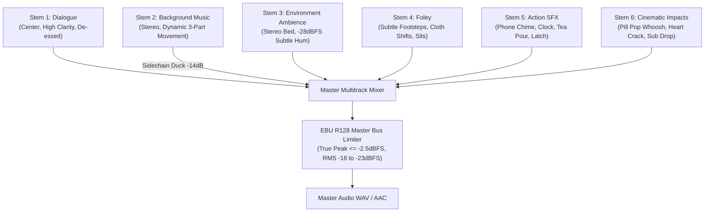

# MASTER AI — PHASE 7.10: SOUND DESIGN & MULTI-TRACK AUDIO SPECIFICATION
## Procedural Scoring, 6-Stem Sound-Event Timeline & EBU R128 Mastering

**System Module**: `F:\Master AI\00_CORE_SYSTEM\engine\sound_design_engine\`  
**Specification Level**: Audio Engineering Protocol  
**Author**: Master AI Video Director Academy  
**Date**: 2026-11-18  

---

## 1. Directorial Problem Statement & Root Cause

Human review of Phase 7.9 highlighted sound design as an unresolved weakness:
> *"Background music and sound effects were not convincing. Music did not match the emotional storyline. Sound effects were poorly selected, poorly timed or ineffective."*

### Forensic Root Cause in Phase 7.9:
1. **Generic Monolithic Drone**: A single ambient synth drone played uniformly across the film without emotional shifts.
2. **Sparse, Disconnected Foley**: Only a handful of spot sound effects were inserted at fixed timestamps, leaving major character actions silent.
3. **Absence of a Formal Sound-Event Timeline**: Sound effects were an afterthought added during final mixdown rather than an integral part of the storyboard and scene composition.

### Benchmark Analysis (`demo_reference.mp4`):
- Music evolves through three distinct emotional movements: playful acoustic bounce $\to$ dramatic minor piano solo $\to$ warm acoustic resolution.
- Spot Foley accents every important visual event: phone chime, clock ticks, pop accents on topic pills, heart crack on emotional injury.
- Audio ducking is smooth and transparent, giving dialogue pristine intelligibility while maintaining musical rhythm.

---

## 2. The 6-Stem Multi-Track Audio Architecture

Phase 7.10 strictly mandates that all audio productions separate sound into **six independent stems** mixed with dedicated EQ, compression, and spatial positioning:



### Stem Definitions & Target Loudness
| Stem ID | Name | Role & Contents | Target Stem Level | Processing Chain |
|:---|:---|:---|:---:|:---|
| **Stem 1** | **Dialogue** | Spoken Hindi characters and narrator | **-14.0 dBFS Peak** | 100Hz High-pass, 3.5kHz presence boost, fast 3:1 compressor, de-esser |
| **Stem 2** | **Music (BGM)** | Dynamic multi-movement emotional score | **-22.0 dBFS RMS** | High-shelf cut at 10kHz, vocal sidechain ducking (-14dB when voice active) |
| **Stem 3** | **Ambience** | Room tone, outdoor street mist, night crickets | **-32.0 dBFS RMS** | Low-level continuous stereo bed (never drops to absolute digital silence) |
| **Stem 4** | **Foley** | Organic character interactions (cloth rustle, footsteps) | **-24.0 dBFS Peak** | Transient shaper, realistic room reverb impulse |
| **Stem 5** | **Action SFX** | Screen elements (phone chime, notification ping, clock) | **-16.0 dBFS Peak** | Crisp punchy transients, stereo panning matching screen position |
| **Stem 6** | **Impacts / Stabs** | Dramatic punctuations (pop whoosh, heartbreak crack) | **-12.0 dBFS Peak** | Sub-bass impact ($45\text{Hz}$), short decay, high emotional punch |

---

## 3. Dynamic Narrative Scoring (The 3-Movement Score)

Forbids playing the same looping music track throughout the film. Every short film score must follow the three-part dramatic progression:

```
00:00                00:30                               00:45               00:60
+--------------------+-----------------------------------+-------------------+
| MOVEMENT 1:        | MOVEMENT 2:                       | MOVEMENT 3:       |
| Light & Playful    | Tension / Melancholy Solo         | Warm Resolution   |
| (Acoustic Rhythm,  | (Beat drops, minor piano chords,  | (Strings swell,   |
|  Rhodes piano,     |  intimate, sparse, reflective)    |  acoustic guitar, |
|  82 BPM bounce)    |                                   |  uplifting glow)  |
+--------------------+-----------------------------------+-------------------+
```

### Transition Rules
1. **Movement 1 $\to$ Movement 2 (The Conflict Drop)**:
   - Synchronized with the inciting crisis / confrontation (e.g. at $t \approx 30\text{s}$).
   - High-energy drums cut abruptly on a shocked reaction cut, leaving a lingering single minor piano note and room reverb.
2. **Movement 2 $\to$ Movement 3 (The Payoff Swell)**:
   - Synchronized with the moment of realization or reconciliation (e.g. at $t \approx 45\text{s}$).
   - Warm acoustic guitar strum or uplifting synth pad blooms into the soundscape, underscoring emotional relief.

---

## 4. The Sound-Event Timeline Protocol

Before final audio assembly, the system generates a structured `sound_events.json` manifest linking every visual event to its exact audio cue:

```json
{
  "sound_events": [
    {
      "timestamp_sec": 0.00,
      "event_type": "music_start",
      "stem": "bgm",
      "preset": "movement_1_playful_acoustic",
      "gain_db": -18.0
    },
    {
      "timestamp_sec": 1.20,
      "event_type": "sfx_phone_chime",
      "stem": "action_sfx",
      "preset": "modern_notification_marimba",
      "gain_db": -12.0,
      "pan": -0.3
    },
    {
      "timestamp_sec": 7.05,
      "event_type": "sfx_clock_tick",
      "stem": "action_sfx",
      "preset": "woodblock_clock_rhythm",
      "gain_db": -22.0,
      "pan": 0.0
    },
    {
      "timestamp_sec": 29.40,
      "event_type": "sfx_pop_accent",
      "stem": "impacts",
      "preset": "bubble_pop_with_whoosh",
      "gain_db": -10.0,
      "pan": 0.0
    },
    {
      "timestamp_sec": 32.80,
      "event_type": "music_transition",
      "stem": "bgm",
      "preset": "movement_2_minor_piano_solo",
      "gain_db": -16.0
    },
    {
      "timestamp_sec": 42.50,
      "event_type": "sfx_heart_crack",
      "stem": "impacts",
      "preset": "dry_ceramic_crack_with_sub_drop",
      "gain_db": -8.0,
      "pan": 0.2
    },
    {
      "timestamp_sec": 48.00,
      "event_type": "music_transition",
      "stem": "bgm",
      "preset": "movement_3_warm_acoustic_resolution",
      "gain_db": -16.0
    }
  ]
}
```

---

## 5. Vocal Sidechain Ducking & EBU R128 Compliance

### Mathematical Ducking Model
When dialogue is detected on Stem 1 ($V_{\text{dialogue}}(t) > -38\text{ dBFS}$), Stem 2 (BGM) gain $G_{\text{bgm}}(t)$ is attenuated automatically:

$$G_{\text{bgm}}(t) = G_{\text{nominal}} \times \left(1.0 - \alpha_{\text{duck}} \cdot \text{Env}_{\text{dialogue}}(t)\right)$$

Where:
- Nominal BGM Gain: $-18.0\text{ dBFS}$
- Maximum Ducking Depth $\alpha_{\text{duck}}$: $-14.0\text{ dB}$
- Attack Time: $45\text{ ms}$ (smooth fade down before first consonant)
- Release Time: $350\text{ ms}$ (natural musical decay without pumping artifacts)

### Master Limiter Telemetry Targets
- **Loudness Standard**: EBU R128 / ITU-R BS.1770-4.
- **Integrated Loudness**: $-23.0\text{ LUFS} \pm 1.0\text{ LUFS}$ (Broadcast standard) or $-16.0\text{ LUFS}$ (Mobile streaming standard).
- **True Peak**: $\le -2.50\text{ dBFS}$ (guarantees zero inter-sample clipping on lossy AAC transcoders).
- **Silence Defect Rule**: Audio must never fall below $-45\text{ dBFS}$ for more than $0.40\text{s}$ at any point in the timeline.
