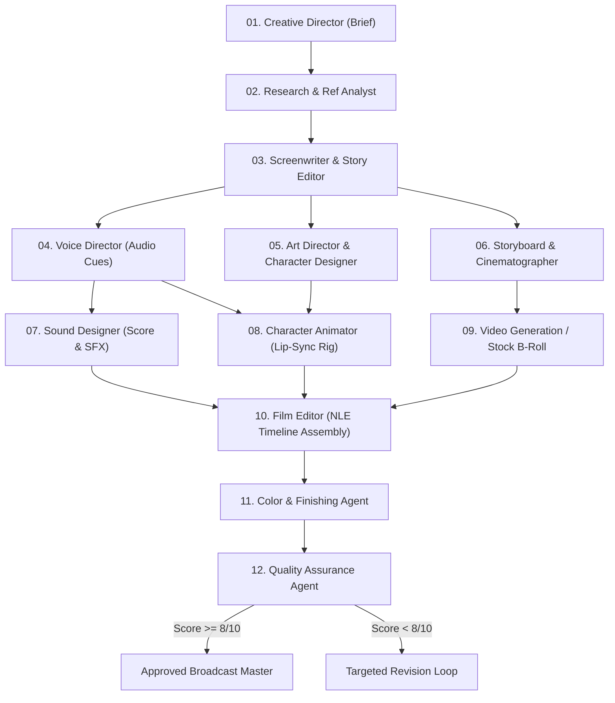

# MASTER AI: PRODUCTION AGENT ARCHITECTURE (16 SPECIALIST ROLES)
**Target Output**: `F:\Master AI\00_CORE_SYSTEM\research\phase-7\phase-7.12\production_agent_architecture.md`  
**Date**: 2026-11-18  
**Scope**: Logical responsibility matrix, task delegation protocol, dependency handling, and error recovery for Master AI video production.

---

## 1. Architectural Philosophy: Logical Responsibilities vs. Process Bloat

Master AI structures film production across **16 specialized production roles**. 

> **Critical Architecture Principle**: These 16 roles are **logical responsibilities and specialized skills**, NOT a requirement to spawn 16 separate expensive LLM processes for every single sub-task. The central Orchestrator manages the production graph, invoking specialist capabilities sequentially or in parallel batches where dependencies permit.

```
                               ┌─────────────────────────────┐
                               │ Executive Creative Director │
                               └──────────────┬──────────────┘
                                              │
                 ┌────────────────────────────┼────────────────────────────┐
                 ▼                            ▼                            ▼
      [Story & Pre-Production]       [Visuals & Animation]       [Sound & Post-Production]
      ├── Research Agent             ├── Art Director            ├── Voice Director
      ├── Screenwriter               ├── Character Designer      ├── Sound Designer
      ├── Story Editor               ├── Environment Designer    ├── Film Editor
      └── Storyboard Artist          ├── Cinematographer         └── Color & Finishing
                                     ├── Video Generation Agent
                                     └── Character Animation
                                              │
                                              ▼
                                 ┌───────────────────────────┐
                                 │ Quality Assurance Agent   │
                                 └───────────────────────────┘
```

---

## 2. The 16 Specialist Roles & Responsibility Matrix

| Role # | Specialist Title | Stage in Pipeline | Primary Input | Expected Output Deliverable | Mandatory Skill Loaded |
| :---: | :--- | :--- | :--- | :--- | :--- |
| **01** | **Executive Creative Director** | Phase Conception & Oversight | User Prompt / Brief | Production Manifest & Creative Mandate | `creative-direction` |
| **02** | **Research Agent** | Discovery & Benchmarking | Topic / Inspiration URL | Market Dossier & Reference Extraction | `visual-research` |
| **03** | **Reference Video Analyst** | Reference Forensic Audit | Reference MP4 / URL | Forensic Grammar & Structure Breakdown | `reference-analysis` |
| **04** | **Screenwriter** | Narrative Formulation | Creative Mandate | 4-Act Screenplay with Scene Beats | `story-writing` |
| **05** | **Story Editor** | Dialogue & Pacing Tuning | Screenplay Draft | Polished Script & Conversational Timeline | `dialogue-writing` |
| **06** | **Art Director** | Visual Identity & Color | Screenplay & Genre | Visual Style Guide & Color Master | `color-grading` |
| **07** | **Character Designer** | Character Rigging & Assets | Character Brief | Model Sheets, Rigs & SVG Atlases | `character-design` |
| **08** | **Environment Designer** | Backgrounds & Settings | Scene Locations | 1080×1920 Stage & Backdrop Assets | `visual-generation` |
| **09** | **Storyboard Artist** | Visual Blueprint | Screenplay & Model Sheets | 9:16 Storyboard with Shot Scales | `storyboard` |
| **10** | **Cinematographer** | Camera Language & Lens | Storyboard & Cuts | Director Shot Plan & Camera Easing | `cinematography` |
| **11** | **Video Generation Agent** | Footage & B-Roll Sourcing | Shot Plan Prompts | Rendered Video Clips (MP4/WebM) | `visual-generation` |
| **12** | **Character Animation Agent** | Character Acting & Motion | Rigs, Audio & Cues | Articulated Motion Layers & Lip-Sync | `character-animation` |
| **13** | **Voice Director** | Vocal Delivery & Acting | Polished Dialogue | Neural Speech Tracks (Edge-TTS) | `voice-direction` |
| **14** | **Sound Designer** | Music & SFX Synthesis | Emotion Graph & Timing | Dynamic Score & Mastered Audio Mix | `sound-design` |
| **15** | **Film Editor** | Timeline Assembly & Cuts | Clips, Layers & Audio | NLE Assembly Timeline (1080×1920) | `video-editing` |
| **16** | **Quality Assurance Agent** | Verification & Gatekeeping | Master MP4 & Streams | Technical & Creative QA Scorecard | `quality-review` |

---

## 3. Dependency Pipeline Graph & Execution Flow



---

## 4. Stage Contract Specification

Every stage execution in Master AI enforces a strict contract:
1. **Input Schema**: Typed JSON file containing assets produced by prerequisite stages.
2. **Preflight Check**: Verifies that prerequisite files exist and meet minimum byte size / integrity checks.
3. **Skill Loading**: The designated `SKILL.md` is loaded into active context before generating prompts or code.
4. **Execution Timeout**: Defined per stage (e.g. 15s for script validation, 120s for video rendering).
5. **Validation Criteria**: Automated schema and perceptual checks on the output artifact.
6. **Error Recovery & Fallback**:
   - Level 1: Automatic parameter retry with relaxed thresholds.
   - Level 2: Alternate provider fallback (e.g., if AI video model unavailable, fallback to stock B-roll harvester).
   - Level 3: Human checkpoint escalation.
