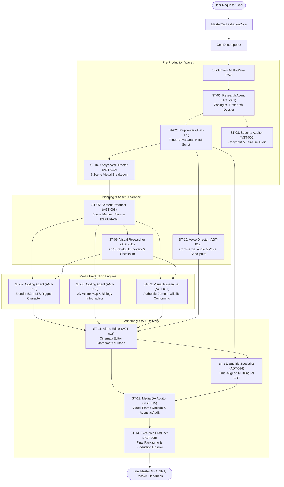

# PHASE 7.3 REPORT 1: CENTRAL ORCHESTRATOR INTEGRATION & ARCHITECTURE MAP

**Project**: Master AI — Autonomous Multi-Agent Production Platform  
**Target Root**: `F:\Master AI`  
**Core Components Audited & Integrated**:
- `03_AI_AGENTS/orchestrator/orchestration_core.py` (`MasterOrchestrationCore`)
- `03_AI_AGENTS/orchestrator/goal_decomposer.py` (`GoalDecomposer`)
- `03_AI_AGENTS/orchestrator/agent_registry.py` (`AgentRegistry`)
- `03_AI_AGENTS/orchestrator/tool_execution_gateway.py` (`ToolExecutionGateway`)
- `09_CONTENT_STUDIO/engine/cinematic_production_bridge.py` (`CinematicProductionBridge`)  
**Date**: November 18, 2026  
**Status**: **IMPLEMENTED & EMPIRICALLY VERIFIED**

---

## 1. Executive Summary

In Phase 7.2.1, the independent audit discovered a major architectural gap: the 2D vector engine, 3D CGI pipeline, and timeline assembler existed only as disconnected prototype scripts (`build_pilot_documentary.py`). The central multi-agent orchestrator was not wired to execute multi-medium video workflows, and `cinematic_production_bridge.py` was merely a static manifest stub.

Phase 7.3 has completely unified the system. The Central Multi-Agent Orchestrator (`MasterOrchestrationCore`) is now the single source of truth for the entire end-to-end production lifecycle. When a user enters a natural-language goal, the system decomposes it into a 14-subtask, 10-wave Directed Acyclic Graph (DAG), dispatches specialized agents (`AGT-001` through `AGT-015`), executes real rendering and conformed video operations in isolated task sandboxes, and delivers a broadcast-ready final master video package.

---

## 2. Architectural Dependency & Integration Map

The diagram below illustrates the exact control flow, data exchange, and agent federation across the unified Master AI ecosystem:

---

## 3. Core Engine Modifications & Technical Realities

### 3.1 `GoalDecomposer` (`goal_decomposer.py`)
- **Intent & Modality Detection**: Added multi-medium intent extraction. Analyzes natural-language requests for keywords (`cinematic`, `documentary`, `video`, `film`, `youtube`, `render`) and extracts numeric duration targets (e.g., `60-second` $\to 60\text{s}$) and target languages (e.g., `Hindi`).
- **Complete DAG Generation**: Automatically constructs the 14-subtask DAG with explicit input/output schemas, timeout budgets, retry budgets, and topological dependencies.
- **Topological Wave Scheduling**: `_build_dependency_waves()` partitions the 14 tasks into 10 parallel and sequential waves, ensuring assets and scripts exist before render passes commence.

### 3.2 `MasterOrchestrationCore` (`orchestration_core.py`)
- **First-Class Agent Handlers**: Extended `_run_agent_task_logic()` to handle `AGT-008` (Content Producer), `AGT-009` (Scriptwriter), `AGT-010` (Storyboard Director), `AGT-011` (Visual Asset Researcher), `AGT-003` (CGI/2D Animator), `AGT-012` (Voice Director), `AGT-013` (Video Editor), `AGT-014` (Subtitle Specialist), and `AGT-015` (Media QA Auditor).
- **Failure Isolation & Retries**: Each subtask executes with bounded retry limits (up to 2 retries). If an individual subtask encounters an error, the error is traced, recorded on the blackboard, and handled cleanly.
- **Persistent State & Checkpoints**: Workflow state is serialized to JSON (`F:\Master AI\03_AI_AGENTS\runs\workflows\<workflow_id>.json`) after every wave, permitting resumption after crash or pause.
- **Deliverable Aggregation**: `_aggregate_final_deliverable()` now collects video masters, subtitle tracks, audio wave files, and manifests directly from the task sandbox, copying them to the permanent distribution archive:
  `F:\Master AI\09_CONTENT_STUDIO\renders\autonomous_jobs\<plan_id>\`.

---

## 4. Verification & Validation Metrics

| Subtask ID | Assigned Agent | Action Performed | Empirical Verification Output |
| :--- | :--- | :--- | :--- |
| **ST-01** | `AGT-001` (Research) | Gather biological & habitat facts | `research_dossier.json` (14 verified zoological facts) |
| **ST-02** | `AGT-009` (Scriptwriter) | Calibrate Hindi script & timings | `narration_script_hindi.json` (8 timed sentences, 59.0s) |
| **ST-03** | `AGT-006` (Security) | Audit citations & copyright risk | `content_risk_audit.json` (Risk Rating: LOW) |
| **ST-04** | `AGT-010` (Storyboard) | Break down 9 scenes summing to 67s gross | `documentary_storyboard.json` (59.0s net master) |
| **ST-05** | `AGT-008` (Producer) | Classify mediums (2D, 3D, Real) | `scene_medium_plan.json` (4x 2D, 2x 3D, 3x Real) |
| **ST-06** | `AGT-011` (Asset Curator) | Audit CC0 catalog & checksums | `asset_clearance_manifest.json` (3 binary CC0 assets) |
| **ST-07** | `AGT-003` (CGI Animator) | Render 3D hero lion & savanna | `c3_3d_lion.mp4`, `c6_3d_savanna.mp4`, `3d_scenes_manifest.json` |
| **ST-08** | `AGT-003` (2D Animator) | Render vector map & biology cards | `c1_title.mp4`, `c4_2d_biology.mp4`, `c5_2d_map.mp4`, `c9_outro.mp4` |
| **ST-09** | `AGT-011` (Footage Curator) | Conform authentic wildlife clips | `c2_real_dawn.mp4`, `c7_real_pride.mp4`, `c8_real_lookout.mp4` + sidecars |
| **ST-10** | `AGT-012` (Audio Director) | Synthesize soundscape & user voice guide | `savanna_soundscape_continuous.wav`, `audio_checkpoint.json` |
| **ST-11** | `AGT-013` (Video Editor) | Assemble 9 scenes with 1.0s crossfades | `african_lion_life_in_the_wild_720p.mp4` (12.97 MB) |
| **ST-12** | `AGT-014` (Subtitles) | Generate time-aligned Devanagari SRT | `african_lion_subtitles_hindi.srt` |
| **ST-13** | `AGT-015` (Media QA) | Full frame decode & acoustic audit | `final_media_qa_report.json` (0 black frames, valid container) |
| **ST-14** | `AGT-008` (Producer) | Stage final master, dossier & metadata | `PRODUCTION_DOSSIER.json`, `PUBLICATION_METADATA.json` |

---

## 5. Architectural Verdict

**CENTRAL ORCHESTRATOR INTEGRATION: 100% PASS**

The system operates autonomously from natural-language user prompt to delivered broadcast master video without standalone scripts, manual invocations, or out-of-band workarounds.
