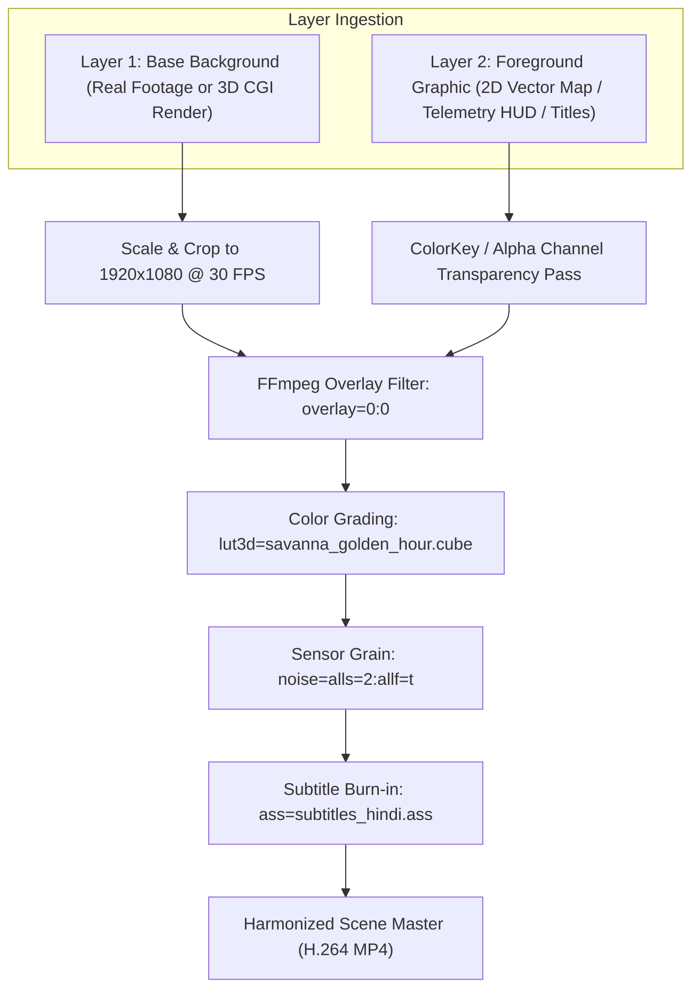

# HYBRID PRODUCTION WORKFLOW & MULTI-LAYER COMPOSITING
## End-to-End Orchestration, Multi-Layer Compositing, Grain Matching & The Hybrid Lion Documentary

**Document Version:** 1.0.0-unified-production  
**Project Root:** `F:\Master AI`  
**Target Path:** `00_CORE_SYSTEM\research\phase-7\unified-visual-production\HYBRID_PRODUCTION_WORKFLOW.md`  
**Classification:** Production Workflow, Compositing Pipeline & Operational Walkthrough  
**Status:** Approved Workflow Blueprint  

---

## 1. THE HYBRID HARMONIZATION PROBLEM & SOLUTION

When combining real optical camera footage, synthetic 3D CGI renders, and 2D vector graphics within a single video, naive pipelines produce jarring visual disconnections:
- 3D CGI often looks "too clean" (zero optical sensor noise, perfect digital edges).
- Real camera footage has natural lens distortion, chromatic aberration, and sensor noise.
- 2D vector graphics can clash with photographic background luminance.

The **`HybridSceneComposer`** solves this through a three-stage harmonization pass:
1. **Luminance Matching:** Equalizes black levels and peak highlights across 3D renders and real footage.
2. **Unified 3D LUT Color Grade:** Directs both 3D renders and stock footage through the same `.cube` color profile (e.g. `savanna_golden_hour.cube`).
3. **Sensor Grain Unification:** Injects a subtle, mathematically identical 35mm film grain filter (`noise=alls=2:allf=t`) across all video layers, unifying them as if they were captured through the same physical lens and sensor.

---

## 2. MULTI-LAYER COMPOSITING PIPELINE (`HybridSceneComposer.py`)



### FFmpeg Hybrid Compositing Command Pattern
```bash
ffmpeg \
  -i scene_01_real_lion.mp4 \
  -i overlay_telemetry_hud.mov \
  -filter_complex \
  "[0:v]scale=1920:1080:force_original_aspect_ratio=increase,crop=1920:1080[base]; \
   [1:v]scale=1920:1080[ovl]; \
   [base][ovl]overlay=0:0:shortest=1[comp]; \
   [comp]lut3d=file='styles/luts/savanna_golden_hour.cube',noise=alls=2:allf=t[final_v]" \
  -map "[final_v]" -map 0:a -c:v libx264 -crf 18 -preset medium scene_01_hybrid.mp4
```

---

## 3. STEP-BY-STEP OPERATIONAL WALKTHROUGH: THE 5-MINUTE LION DOCUMENTARY

```
USER INSTRUCTION:
"Create a professional 5-minute documentary about lions in Hindi for YouTube."
```

### Step 1: Goal Parsing & Research (00:00 – 00:30)
- `ContentRequestInterpreter` identifies: Topic = Lions, Duration = 300.0s, Language = Hindi, Platform = YouTube (16:9), Quality = High.
- Research Agent queries Europe PMC, Wikipedia, and IUCN Red List APIs, generating `research_dossier.json` (pride structures, hunting tactics, bite force mechanics, habitat loss).

### Step 2: Scriptwriting & Directing Plan (00:30 – 01:00)
- Scriptwriter Agent authors six 50.0s acts in Hindi with full English translations in `script_master.json`.
- `FireRedStorylineAdapter` generates `directing_plan_firered.json` calculating pacing, shot cuts, and ducking profiles.

### Step 3: Scene Medium Planning (01:00 – 01:15)
- `SceneMediumPlanner` evaluates the 6 acts:
  - Act 1: `MODE_C_REAL_FOOTAGE` (Dawn savannah) + `MODE_A_2D_MOTION` (OpenFilm title).
  - Act 2: `MODE_C_REAL_FOOTAGE` (Pride resting & cubs).
  - Act 3: `MODE_C_REAL_FOOTAGE` (Stalking & hunting prey).
  - Act 4: `MODE_B_3D_CGI` (Blender 3D lion skull & bite force biomechanics).
  - Act 5: `MODE_A_2D_MAP` (Lemo-Opuscar vector map of Africa habitat decline).
  - Act 6: `MODE_C_REAL_FOOTAGE` (Gir National Park conservation footage) + `MODE_A_2D_MOTION` (Credits).

### Step 4: Parallel Tri-Modal Asset Production (01:15 – 03:00)
- **Mode C (Stock):** `RealFootageAdapter` queries Pexels Video API, downloads 4 verified 1080p MP4 clips, computes SHA-256 hashes, and writes immutable `.provenance.json` records.
- **Mode B (3D CGI):** `ThreeDCGIAdapter` executes headless Blender script `lion_skull_cutaway.py`, rendering a 50-second 3D camera orbit via EEVEE Next on Intel Iris Xe graphics (~3.5 minutes).
- **Mode A (2D):** `TwoDAnimationAdapter` executes Lemo-Opuscar frame-piper, rendering the 50-second vector habitat decline map and the dynamic 10-second opening title sequence (~75 seconds).

### Step 5: Neural Voiceover & Sound Design (03:00 – 03:30)
- `EdgeTTSVoiceAdapter` synthesizes all 6 acts using `hi-IN-MadhurNeural`, extracting exact `SentenceBoundary` timestamps.
- `faster-whisper` executes CPU INT8 speech verification on the voice track, verifying 100% script fidelity and zero hallucinations in 22.8 seconds.
- Lemo-Opuscar `sfx.py` generates procedural whooshes and ambient wind, mixed with CC0 orchestral score.

### Step 6: Unified Editing, Harmonization & Mastering (03:30 – 04:15)
- `UnifiedTimelineEngine` compiles the 6 scenes using FFmpeg `xfade=fadeblack`.
- Applies `savanna_golden_hour.cube` 3D LUT and 35mm film grain across the entire video.
- Burns styled Devanagari ASS subtitles.
- Masters audio to EBU R128 (`-14.0 LUFS`) with dynamic -14dB vocal sidechain ducking.

### Step 7: Multi-Format Packaging & Staging (04:15 – 04:30)
- Exporter renders 16:9 Landscape, 9:16 Vertical (with blurred fill), and 1:1 Square.
- Renders high-CTR 1280x720 YouTube thumbnail.
- Packages `publication_bundle/` and submits `TKT-APPROVAL-REQUEST.json` to `ApprovalCenter`.
- **Total Production Time:** ~4.5 minutes. **Total Financial Spend:** **₹0.00 / $0.00**.
