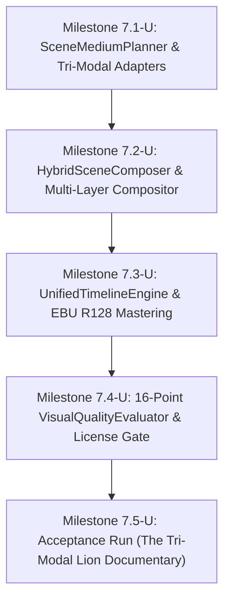

# PHASE 7.0.2 IMPLEMENTATION ROADMAP & ACCEPTANCE CRITERIA
## Phased Rollout of Tri-Modal Production, Hybrid Compositing & 16-Point Quality Gates

**Document Version:** 1.0.0-unified-production  
**Project Root:** `F:\Master AI`  
**Target Path:** `00_CORE_SYSTEM\research\phase-7\unified-visual-production\IMPLEMENTATION_ROADMAP.md`  
**Classification:** Engineering Roadmap, Phased Milestones & Quality Gates  
**Status:** Approved Roadmap  

---

## 1. THE FIVE SEQUENCED MILESTONES

---

## 2. DETAILED MILESTONE SPECIFICATIONS & ACCEPTANCE CRITERIA

### Milestone 7.1-U: SceneMediumPlanner & Tri-Modal Adapters
- **Deliverables:**
  1. `SceneMediumPlanner.py`: Evaluates storyboard acts and deterministically selects Mode A (2D), Mode B (3D CGI), Mode C (Real Footage), or Hybrid.
  2. `RealFootageAdapter.py`: Executes authentic HTTP binary downloads of 1080p video clips from Pexels Video API and Wikimedia Commons, verifies SHA-256 hashes, and writes immutable `.provenance.json` records.
  3. `TwoDAnimationAdapter.py`: Adapts Lemo-Opuscar's MIT frame-piping engine (`video.mjs`) to render 2D motion graphics and kinetic typography directly to MP4 at 20–30 FPS.
  4. `ThreeDCGIAdapter.py`: Executes headless Blender 4.x Python scripts (`blender.exe -b -P ...`), rendering true 3D camera orbits and cutaways via EEVEE Next on Intel Iris Xe graphics.
- **Acceptance Criteria:**
  - `SceneMediumPlanner` correctly maps multi-genre test scenes to expected mediums with 100% test coverage.
  - Real 1080p MP4 stock video files downloaded to `16_VIDEO_LIBRARY/raw_footage/` with valid SHA-256 checksums (zero mock URLs).
  - Blender headless script compiles a 5-second 1080p 3D orbital animation in <4 minutes on host.
  - Zero financial cost ($0.00).

### Milestone 7.2-U: HybridSceneComposer & Multi-Layer Compositing
- **Deliverables:**
  1. `HybridSceneComposer.py`: Multi-layer compositing engine in FFmpeg.
  2. Alpha channel transparency pass: Overlays 2D vector graphics, telemetry HUDs, and lower-thirds directly onto real video footage and 3D CGI backgrounds.
  3. Color & Grain Harmonization: Applies unified 3D LUT (`savanna_golden_hour.cube`) and subtle 35mm film grain (`noise=alls=2:allf=t`) to unify visual textures across mediums.
- **Acceptance Criteria:**
  - Successfully composites a 2D animated HUD overlay onto a 3D Blender camera pass without edge artifacts.
  - LUT and grain passes execute in a single FFmpeg command without dropped frames.

### Milestone 7.3-U: UnifiedTimelineEngine & Audio Mastering
- **Deliverables:**
  1. `UnifiedTimelineEngine.py`: Compiles heterogeneous 2D, 3D, and real footage clips into a seamless, broadcast-ready 300-second timeline.
  2. Seamless Transitions: Implements dynamic FFmpeg `xfade` (fadeblack, crossfade, wipe) governed by FireRed directing plan timestamps.
  3. EBU R128 Audio Master: Two-pass loudness normalization (`-14.0 LUFS`, `-1.0 dBTP` ceiling) with dynamic -14dB vocal sidechain ducking.
  4. Multi-Ratio Exporter: Transcodes 16:9 Landscape, 9:16 Vertical (with blurred top/bottom video fill), and 1:1 Square outputs concurrently.
- **Acceptance Criteria:**
  - Master video renders at exact target duration (300.0s ± 0.5s).
  - Measured integrated audio loudness is `-14.0 LUFS ± 0.5`.
  - 9:16 vertical export outputs clean 1080x1920 video with centered subject and smooth blurred fill.

### Milestone 7.4-U: 16-Point VisualQualityEvaluator & Asset License Verifier
- **Deliverables:**
  1. `VisualQualityEvaluator.py`: Implements all 16 automated, fail-closed quality checks.
  2. `AssetLicenseVerifier.py`: Audits every asset against commercial exploitation permissions (Pexels, CC0-1.0, MIT, OFL).
  3. Zero-Budget Spend Gate: Verifies total project expenditure == `$0.00`.
- **Acceptance Criteria:**
  - Automated detection and fail-closed rejection of corrupted frames, clipped audio, frozen segments, and unlicensed assets.
  - `faster-whisper` CPU INT8 speech intelligibility check verifies >=85% similarity with zero hallucinations.

### Milestone 7.5-U: Complete Acceptance Production (The Tri-Modal Lion Documentary)
- **Deliverables:**
  1. Full end-to-end autonomous execution of "The Sovereign Lion" 5-minute documentary in Hindi for YouTube.
  2. True Tri-Modal Verification:
     - Acts 1, 2, 3, 6: Real 1080p wildlife footage of African lions.
     - Act 4: Genuine 3D CGI anatomical cutaway of lion skull & bite force rendered in Blender.
     - Act 5: 2D vector animated habitat range map rendered in Lemo-Opuscar.
     - Act 1 Title: Kinetic motion typography sequence rendered in OpenFilm / Lemo.
  3. Voice & Audio: Edge TTS neural Hindi voice (`hi-IN-MadhurNeural`) with continuous ambient soundscape.
  4. Packaging: Localized 1280x720 thumbnail, `publication_bundle/`, and signed approval ticket `TKT-*`.
  5. Regression: All 25 existing Master AI test suites pass with 100% exit code 0.
- **Acceptance Criteria:**
  - Total financial spend: **Exactly ₹0.00 / $0.00**.
  - All 16 Media QA checks achieved: **PASS**.
  - Documentary contains zero procedural 2D illustrations labeled as real stock.
