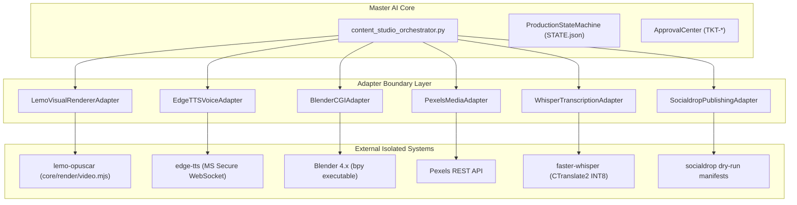

# GITHUB REPOSITORY INTEGRATION PLAN
## Modular Adapter Design, License Compliance, Clean-Room Boundaries & Security Isolation

**Document Version:** 1.0.0-zero-budget  
**Project Root:** `F:\Master AI`  
**Target Path:** `00_CORE_SYSTEM\research\phase-7\zero-budget\GITHUB_REPOSITORY_INTEGRATION_PLAN.md`  
**Classification:** Software Architecture, Open-Source Governance & Modular Integration  
**Status:** Approved Integration Blueprint  

---

## 1. REPOSITORY SELECTION & INTEGRATION MATRIX

To build a professional cinematic production house at ₹0, Master AI integrates seven audited open-source repositories through modular, decoupled adapters:

| Repository & Source | Primary Role in Master AI | Governing License | Commercial Rights | Security & Sandbox Isolation | Target Master AI Adapter |
| :--- | :--- | :--- | :--- | :--- | :--- |
| **`lemomo-ai/lemo-opuscar`** | Headless Canvas/WebGL frame-piping to FFmpeg | **MIT License** (Core Code) | **Allowed** (Core code only) | Isolated in `external_repos/`. Never bundle CC BY-NC docs or Clawd. | `LemoVisualRendererAdapter` |
| **`rany2/edge-tts`** | Zero-cost neural Hindi & multilingual TTS | **GPL v3 / Python** | **Allowed** (Client protocol) | Isolated WebSocket child process; no credential exposure. | `EdgeTTSVoiceAdapter` |
| **`SYSTRAN/faster-whisper`** | CPU INT8 speech verification & subtitle sync | **MIT License** | **Unrestricted Commercial** | Local CTranslate2 binary; zero outbound network calls. | `WhisperTranscriptionAdapter` |
| **`Pexels Video API Client`** | Genuine commercial-grade 1080p stock footage | **MIT / Pexels License** | **Full Commercial Use** | Downloaded to `16_VIDEO_LIBRARY/`; verified via SHA-256. | `PexelsMediaAdapter` |
| **`Blender 4.x (bpy)`** | Deterministic 3D CGI scene synthesis | **GNU GPL v3** | **Output 100% Owned by User** | Headless subprocess execution (`blender.exe -b -P ...`). | `BlenderCGIAdapter` |
| **`socialdrop/socialdrop`** | Multi-platform staged packaging manifests | **MIT License** | **Unrestricted Commercial** | Dry-run staging mode only behind `ApprovalCenter` (`TKT-*`). | `SocialdropPublishingAdapter` |
| **`openvinotoolkit/openvino`** | Local SD 1.5 image generation on Intel Iris Xe | **Apache 2.0** | **Unrestricted Commercial** | Local OpenVINO runtime; no telemetry or data leakage. | `OpenVINOImageAdapter` |

---

## 2. MODULAR ADAPTER PATTERNS & CLEAN-ROOM SEGREGATION

Every external repository connects to Master AI exclusively through an interchangeable adapter implementing a strict boundary contract:

### Clean-Room Governance Rules
1. **Zero Monolithic Vendoring:** External repositories must never be dumped directly into Master AI's primary source trees. They remain strictly isolated under `00_CORE_SYSTEM/research/external_repos/` or invoked as modular system tools.
2. **Strict License Segregation:** No CC BY-NC 4.0 documentation, style prompts, or Anthropic "Clawd" assets from Lemo-Opuscar may be imported or redistributed inside Master AI. Master AI authors its own clean-room HTML5 styles and system prompts.
3. **No Root Privilege / Administrator Dependency:** Every tool and subprocess runs entirely within standard user permissions on Windows 11.
