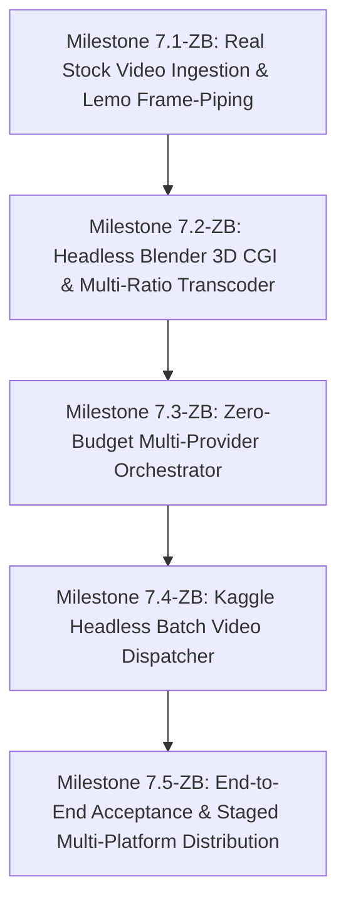

# ZERO-BUDGET IMPLEMENTATION ROADMAP (PHASE 7.1–7.5)
## Phased Zero-Cost Execution, Tiered Technical Capabilities & Hardened Milestones

**Document Version:** 1.0.0-zero-budget  
**Project Root:** `F:\Master AI`  
**Target Path:** `00_CORE_SYSTEM\research\phase-7\zero-budget\ZERO_BUDGET_IMPLEMENTATION_ROADMAP.md`  
**Classification:** Engineering Roadmap, Phased Milestones & Acceptance Criteria  
**Status:** Approved Roadmap  

---

## 1. THE FIVE CAPABILITY TIERS

Under the permanent ₹0 / $0 budget rule, Master AI categorizes all technologies into five strict tiers:

```
┌────────────────────────────────────────────────────────────────────────┐
│                   ZERO-BUDGET TECHNICAL CAPABILITY TIERS               │
├────────────────────────────────────────────────────────────────────────┤
│ TIER A: IMMEDIATELY USABLE FREE LOCAL CAPABILITIES                     │
│ • FFmpeg 7.1 Complex Filtergraph & Format Transcoding                  │
│ • Microsoft Edge TTS Neural Speech (Devanagari Hindi & English)        │
│ • faster-whisper CPU INT8 Speech Verification (13.1x Real-Time)        │
│ • Lemo-Opuscar sfx.py Procedural Foley & Pink-Noise Synthesizers       │
│ • SubtitleEngine (Styled ASS & SRT Devanagari Generation)              │
│ • PIL / Pillow Typography & Thumbnail Studio                           │
├────────────────────────────────────────────────────────────────────────┤
│ TIER B: FREE OPEN-SOURCE SYSTEMS RUNNABLE ON OUR HOST PC               │
│ • Blender 4.x Headless Python (bpy) on Intel Iris Xe Direct3D 11 / CPU │
│ • Lemo-Opuscar MIT Headless Chromium Frame-Piping (3 Workers @ 20 FPS) │
│ • Local Ollama LLM Inference (Llama 3.2 3B Q4 @ ~30 tokens/sec)        │
│ • OpenVINO SD 1.5 Image Synthesis on Intel Iris Xe (~90–120s / image)  │
│ • Meta MusicGen-small CPU Music Synthesis (~60s for 15s acoustic loop) │
├────────────────────────────────────────────────────────────────────────┤
│ TIER C: INCOMPATIBLE WITH LOCAL HARDWARE (STRICTLY REJECTED LOCALLY)   │
│ • Alibaba Wan 2.1 14B / HunyuanVideo 13B (Requires 24–32 GB CUDA VRAM) │
│ • FLUX.1-schnell / SDXL (Causes severe CPU thrashing and swap stalls)  │
│ • Local execution of these models is STRICTLY BANNED on this host.     │
├────────────────────────────────────────────────────────────────────────┤
│ TIER D: LEGITIMATE FREE CLOUD SERVICES (VERIFIED QUOTAS & ZERO-PAID)   │
│ • Kaggle Notebooks: 30 hours / week free NVIDIA T4 GPU (Batch Video)   │
│ • Google AI Studio: Gemini 2.0 Flash API (15 RPM / 1M TPM free forever)│
│ • Groq Cloud: Llama 3.3 70B Free Tier (High-speed narrative planning)  │
│ • Pexels Video API: 20,000 free 1080p wildlife video requests / month  │
│ • Wikimedia Commons: Unlimited public domain & CC0 media ingestion     │
├────────────────────────────────────────────────────────────────────────┤
│ TIER E: PERMANENTLY DEFERRED FEATURES (UNAVAILABLE AT ₹0)             │
│ • Unreal Engine 5.x Movie Render Queue (Requires $1,500+ dedicated GPU)│
│ • Real-Time 4K Generative Video Diffusion (No free real-time engine)   │
│ • Paid Voice Cloning (ElevenLabs commercial subscriptions)             │
└────────────────────────────────────────────────────────────────────────┘
```

---

## 2. PHASED ZERO-BUDGET IMPLEMENTATION SEQUENCE



---

## 3. MILESTONE SPECIFICATIONS & ACCEPTANCE CRITERIA

### Milestone 7.1-ZB: Real Stock Video Ingestion & Lemo Frame-Piping Core
- **Objectives:**
  1. Upgrade `PexelsMediaAdapter` and `WikimediaMediaAdapter` to perform real HTTP binary downloads of authentic 1080p wildlife footage with SHA-256 verified `.provenance.json` records (replacing simulated URLs).
  2. Implement `LemoVisualRendererAdapter` inside `09_CONTENT_STUDIO/engine/`, adapting Lemo-Opuscar's MIT frame-piping engine to compile dynamic motion typography directly into MP4.
  3. Wire `FireRedStorylineAdapter` directing instructions directly into `video_editor.py` timeline cuts.
- **Acceptance Criteria:**
  - Real MP4 stock files downloaded and verified via SHA-256 checksums on disk.
  - Lemo frame-piping renders 1080p motion titles at >=20 FPS on host machine.
  - Directing plan parameters directly modify timeline assembly timestamps.
  - Zero financial cost ($0.00).

### Milestone 7.2-ZB: Headless Blender 3D CGI & Multi-Ratio Transcoder
- **Objectives:**
  1. Build `BlenderCGIAdapter` executing headless `blender.exe -b -P ...` via Python subprocess.
  2. Integrate glTF 2.0 CC0 asset loader (Poly Haven / ambientCG) and procedural camera path generator.
  3. Implement multi-aspect ratio transcoding (16:9 Landscape, 9:16 Vertical with blurred-fill, 1:1 Square).
  4. Integrate 3D LUT cinematic color grading (`lut3d` filter in FFmpeg).
- **Acceptance Criteria:**
  - Blender headless script generates a 10-second 1080p 3D animated orbit on CPU/Iris Xe in <4 minutes.
  - 9:16 vertical render outputs clean 1080x1920 video with centered subject and smooth blurred top/bottom fill.
  - Zero financial cost ($0.00).

### Milestone 7.3-ZB: Zero-Budget Multi-Provider Orchestrator
- **Objectives:**
  1. Implement universal `BaseLLMAdapter`, `BaseVideoAdapter`, and `BaseVoiceAdapter` interfaces.
  2. Wire local Ollama (`llama3.2:3b`), Groq free tier, and Google AI Studio (Gemini 2.0 Flash) into the orchestrator with automated failover.
  3. Integrate the Pre-Flight Zero-Spend Circuit Breaker locking budget strictly to `$0.00`.
- **Acceptance Criteria:**
  - Orchestrator functions 100% offline using local Ollama if network is disconnected.
  - If network is available, seamlessly leverages Groq / Gemini free tiers for deep research.
  - Any operation attempting spend > $0.00 is immediately blocked.

### Milestone 7.4-ZB: Kaggle Headless Batch Video Dispatcher
- **Objectives:**
  1. Build `KaggleBatchVideoAdapter` utilizing the official `kaggle` Python API.
  2. Automate headless kernel push, remote T4 GPU execution of `Wan2.1-T2V-1.3B`, and automated output retrieval.
  3. Implement 28-hour weekly quota tracking with automatic failover to local 3D Blender / Pexels stock.
- **Acceptance Criteria:**
  - Successfully dispatches and retrieves a 5-second 720p AI video shot from Kaggle T4 at ₹0.
  - Quota tracker accurately halts dispatch when approaching weekly limits.

### Milestone 7.5-ZB: End-to-End Acceptance & Staged Multi-Platform Distribution
- **Objectives:**
  1. Execute a complete 5-minute documentary production ("The Sovereign Lion") combining genuine 1080p stock footage, Blender 3D CGI, Lemo kinetic titles, and Edge TTS Hindi narration.
  2. Generate the complete `publication_bundle/` (16:9, 9:16, 1:1, thumbnails, metadata).
  3. Pass all 16 Media QA checks, run full test suite regression (25/25 passing).
- **Acceptance Criteria:**
  - Total project financial cost: **₹0.00 / $0.00**.
  - Final video contains **real wildlife camera footage**, genuine 3D CGI, and zero procedural 2D illustrations labeled as stock.
  - 100% test pass rate across all Master AI test suites.
